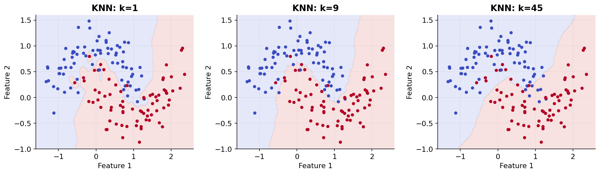

# 12 — K-nearest neighbours and distance

[Course map](README.md) · [Practicals](../02-practicals/README.md) · [Questions and answers](../03-questions-and-answers/worked-questions.md#lesson-12)

## On this page

- [Predict by looking nearby](#predict-by-looking-nearby)
- [Tune what “near” means](#tune-what-near-means)

## Predict by looking nearby

KNN stores training examples. For a new point, compute distances, retrieve $k$ neighbours and vote for classification or average targets for regression. Weighted KNN gives closer neighbours more influence, for example $a_i=1/(d_i+\epsilon)$ with an explicit rule for exact matches. There is no global fitted separating boundary or gradient descent in ordinary KNN.

Euclidean distance is $\sqrt{\sum_j(x_j-z_j)^2}$. Manhattan uses $\sum_j|x_j-z_j|$; Minkowski generalizes the power. Cosine similarity compares direction and is often useful for sparse text/embeddings. Hamming suits matching binary/categorical patterns. The metric is a modelling choice: a dollar difference and an age difference cannot be combined meaningfully without thinking about scale.

For query $x=3$, training $(x,y)=[(1,10),(2,20),(4,40),(8,80)]$, the nearest two are 2 and 4. Uniform KNN regression predicts $(20+40)/2=30$. With $k=1$, a tie between 2 and 4 requires a documented tie-breaking convention; do not present one answer as uniquely determined.

## Tune what “near” means

| Choice | Low / small value | High / large value |
|---|---|---|
| k | Flexible, noisy, low training error | Smooth, may underfit |
| Distance weighting | Uniform votes can let far neighbours dominate | Strong local weighting can amplify noise |
| Number of features | Distances can remain meaningful | Irrelevant dimensions dilute neighbourhoods |

Fit scaling, feature selection and any learned embedding within training folds. Tune $k$, metric and weights. For sparse inputs, avoid centering that destroys sparsity. Impute missing values or use a deliberately supported missingness-aware distance. KD-trees and ball trees can accelerate some low-dimensional queries; high dimension can erase the advantage, and approximate-nearest-neighbour search trades exactness for speed.

**Strengths:** easy intuition, nonlinear boundaries, no strong global functional assumption, useful baseline when nearby examples should behave alike. **Weaknesses:** expensive prediction/storage, sensitivity to scale and irrelevant features, poor extrapolation and fragile distance geometry in high dimensions. KNN regression averages observed targets, so ordinary positive-weight versions cannot extrapolate beyond neighbouring target extremes.

Compare with linear models for sparse high-dimensional data and trees for mixed tabular data. Evaluate repeated queries under a realistic latency budget as well as accuracy. If one customer's duplicates appear in both splits, apparently excellent neighbour prediction may simply be memorization across the split.

---

[← 11: Naive Bayes, LDA and QDA](11-bayes-and-discriminant-analysis.md) · [13: SVM, kernels and support vector regression →](13-support-vector-machines.md)
