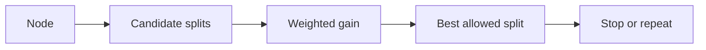
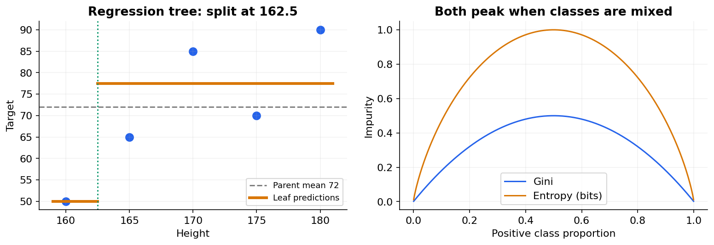

# 14 — Decision trees: entropy, Gini, regression and pruning

[Course map](README.md) · [Practicals](../02-practicals/README.md) · [Questions and answers](../03-questions-and-answers/worked-questions.md#lesson-14)

## On this page

- [Ask useful yes/no questions](#ask-useful-yesno-questions)
- [Calculate a regression split](#calculate-a-regression-split)
- [Prevent memorization](#prevent-memorization)

## Ask useful yes/no questions

A tree recursively splits observations to make child nodes more homogeneous. For numeric data it may ask “income≤50000?”; leaves predict class proportions or a regression summary. CART uses binary splits even for multiclass targets. A categorical predictor may be encoded or handled by an implementation-specific categorical strategy.

For class proportions $p_k$, Gini impurity is $1-\sum p_k^2$ and entropy is $-\sum p_k\log_2p_k$. A candidate split's gain is parent impurity minus sample-weighted child impurity. Choose the greatest positive improvement among allowable candidates, subject to stopping constraints. For squared-error regression, leaves predict means and split gain is weighted variance/MSE reduction.

## Calculate a regression split

Heights $[160,165,170,175,180]$ have targets $[50,65,85,70,90]$. Parent mean 72 gives squared deviations $[484,49,169,4,324]$, total 1030 and MSE 206. Split at 162.5: the left leaf predicts 50; right predicts 77.5. Right squared errors total 425, so weighted child MSE is $425/5=85$. Gain is $206-85=121$. Compare with other allowed thresholds; do not assume the first positive gain is best.

For a class node with 9yes and 5no, entropy is 0.9403 bits. Suppose a split produces 8 examples(6yes,2no) and 6 examples(3yes,3no). Weighted entropy is $(8/14)H(6/8)+(6/14)H(3/6)$; gain is about 0.0481 bits. Information gain is not the raw sum of child entropies.

## Prevent memorization

Greedy growth chooses the best immediate split, not the globally best possible tree. Deep trees can isolate individual training examples. Tune `max_depth`, `min_samples_leaf`, `min_samples_split`, maximum leaves and cost-complexity pruning. Cost-complexity pruning trades fit against a penalty proportional to leaf count; validate its strength. Prefer a reasonable minimum leaf size when probabilities must not come from one or two records.

| Strength | Limitation | Practical response |
|---|---|---|
| Captures thresholds/interactions | Unstable to small data changes | Bagging or forest |
| Little need for scaling | Axis-aligned piecewise boundaries | Feature transforms or other models |
| Easy to inspect when small | Large trees are not meaningfully transparent | Limit size and inspect paths |
| Handles numeric nonlinearities | Regression leaves do not smoothly extrapolate | Evaluate outside-range behaviour |

Impurity feature importance can favour variables with many candidate split points. Validate with held-out permutation importance and correlated-feature caveats. Missing-value handling and native categories differ by estimator, so use the actual supported API. Evaluate held-out performance, leaf sample sizes and subgroup errors; a pretty tree is not proof that its questions reflect causes.

---

[← 13: SVM, kernels and support vector regression](13-support-vector-machines.md) · [15: Bagging, random forests and Extra Trees →](15-bagging-and-forests.md)
