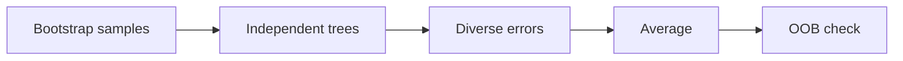
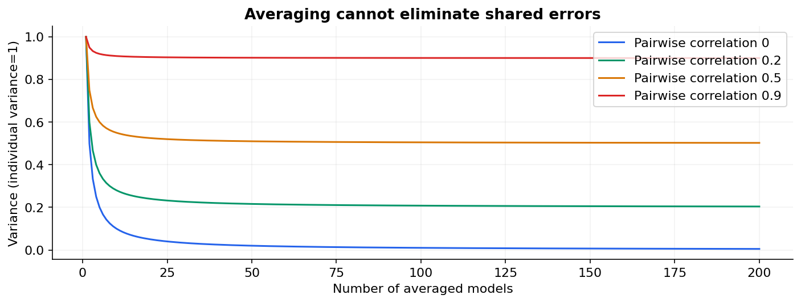

# 15 — Bagging, random forests and Extra Trees

[Course map](README.md) · [Practicals](../02-practicals/README.md) · [Questions and answers](../03-questions-and-answers/worked-questions.md#lesson-15)

## On this page

- [Average models that make different mistakes](#average-models-that-make-different-mistakes)
- [Out-of-bag estimation](#out-of-bag-estimation)

## Average models that make different mistakes

Bagging draws bootstrap samples, fits a base estimator to each and averages numeric predictions or class probabilities. It mainly reduces variance for unstable learners such as deep trees. It cannot rescue a shared leakage problem or a systematically wrong target. Trees can train independently, making bagging naturally parallel.

A random forest adds random subsets of candidate features at each split, reducing correlation between trees. Extra Trees adds randomized split thresholds; exact sampling/bootstrapping defaults depend on the estimator. Both provide nonlinear tabular baselines without the feature scaling required by KNN or SVM.

If individual tree predictions have variance $\sigma^2$ and equal pairwise correlation $\rho$, the average of $B$ trees has variance $\sigma^2[\rho+(1-\rho)/B]$. With $\sigma^2=1,B=100$, independent errors give 0.01; correlation 0.5 gives 0.505. More trees cannot remove the correlated part. The equation is a simplified model of why diversity matters, not an exact performance law for every forest.

## Out-of-bag estimation

A row is omitted from a bootstrap sample with probability $(1-1/n)^n\approx e^{-1}\approx0.368$. Its OOB prediction uses only trees that did not train on it. OOB can estimate error without a separate bagging validation split under suitable independent-row sampling. It does not automatically make a grouped or time-dependent task safe, and repeated tuning to OOB scores still selects on those scores.

| Hyperparameter | Influence | Warning |
|---|---|---|
| Number of trees | Reduces averaging Monte Carlo variation | More compute and storage; little gain eventually |
| Candidate features per split | Controls tree diversity/strength | Too few can miss useful signals |
| Min leaf size / depth | Controls each tree's flexibility | Too shallow can underfit |
| Bootstrap / sample fraction | Changes sample diversity | OOB needs appropriate bootstrap configuration |
| Class weights | Changes training emphasis | Recheck calibration and thresholds |

**Advantages over one tree:** more stable predictions, flexible interactions, often strong with modest preprocessing. **Disadvantages:** less directly interpretable, larger models and slower serving, biased impurity importances, no natural smooth regression extrapolation. Boosting can reduce bias more aggressively but is sequential and often more sensitive to tuning.

Practical use: compare a regularized linear model, a restrained forest and gradient boosting using identical folds. Use held-out permutation importance with caution when predictors are correlated. Do not interpret an ensemble's class probability as automatically calibrated or its default importance ranking as causal evidence.

---

[← 14: Decision trees: entropy, Gini, regression and pruning](14-decision-trees.md) · [16: AdaBoost: learning from weighted mistakes →](16-adaboost.md)
