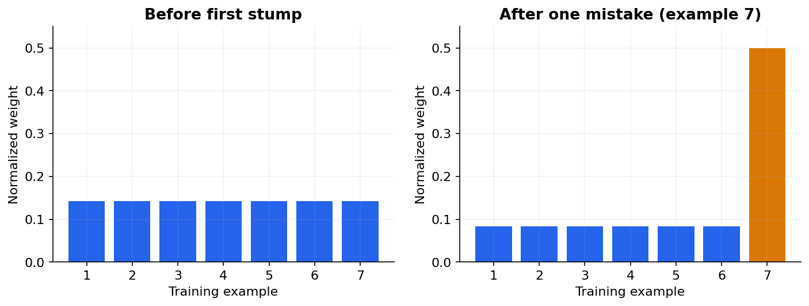

# 16 — AdaBoost: learning from weighted mistakes

[Course map](README.md) · [Practicals](../02-practicals/README.md) · [Questions and answers](../03-questions-and-answers/worked-questions.md#lesson-16)

## On this page

- [Give the next learner a different emphasis](#give-the-next-learner-a-different-emphasis)
- [Seven-example calculation](#seven-example-calculation)
- [Why it works and when it fails](#why-it-works-and-when-it-fails)

## Give the next learner a different emphasis

AdaBoost fits weak classifiers sequentially. In its binary exponential-loss formulation, examples start with equal weights. A weak classifier's weighted error $\epsilon_t$ determines its vote $\alpha_t=\frac12\log[(1-\epsilon_t)/\epsilon_t]$. Increase weights on mistakes, decrease weights on correct predictions, normalize and fit the next learner. The final class is the sign of $\sum_t\alpha_th_t(x)$.

The weight update is $w_i\leftarrow w_i\exp[-\alpha_ty_ih_t(x_i)]$ with labels and predictions $\pm1$. A mistake has $y_ih_t(x_i)=-1$ and gains weight; a correct prediction loses weight. Different multiclass formulations such as SAMME use a different vote formula. Do not apply the binary half-log expression blindly to every implementation.

## Seven-example calculation

Seven rows start at $1/7$. A stump misclassifies one: $\epsilon=1/7$. Its vote is $\alpha=\frac12\log6=0.89588$. After updating and normalizing, the one mistake receives weight 0.5 and each of the six correct rows receives $1/12\approx0.08333$. The next learner now pays much more attention to that one difficult example. This is a reweighting of training evidence, not an independent new dataset and not a modification of the true labels.

## Why it works and when it fails

AdaBoost can be viewed as stagewise additive modelling for exponential loss $\sum_i\exp[-y_iF(x_i)]$. With a useful weak learner, repeated rounds create a nonlinear strong predictor. The exponential penalty strongly emphasizes examples with large negative margins. If a supposedly difficult example is actually mislabeled or an extreme anomaly, repeated emphasis can hurt.

| Choice | Effect | What to validate |
|---|---|---|
| Weak learner depth | More complex learners can fit interactions | Too deep may overfit noise |
| Number of rounds | Adds capacity | Monitor held-out performance |
| Learning rate | Shrinks each learner's contribution | Tune jointly with rounds |
| Sample weights | Alters effective objective | Distinguish business weighting from AdaBoost's internal weights |

Compared with bagging, learners depend on earlier rounds, so straightforward independent tree training is unavailable. Compared with modern gradient boosting, AdaBoost has a particularly clear mistake-reweighting interpretation but less flexible objective choices. Use it as a helpful ensemble baseline and learning bridge, especially with relatively clean labels. For tabular prediction with complex losses or missing/categorical requirements, compare an appropriate boosted-tree implementation.

A binary weak learner with error 0.5 has vote 0 under this formulation; error 0 needs a stopping/clipping rule because the formula diverges. Numerical safeguards and algorithm variants belong to the implementation. Evaluate discrimination and calibration separately because a large ensemble margin is not itself a reliable probability.

---

[← 15: Bagging, random forests and Extra Trees](15-bagging-and-forests.md) · [17: Gradient boosting, XGBoost, LightGBM and CatBoost →](17-gradient-boosting.md)
