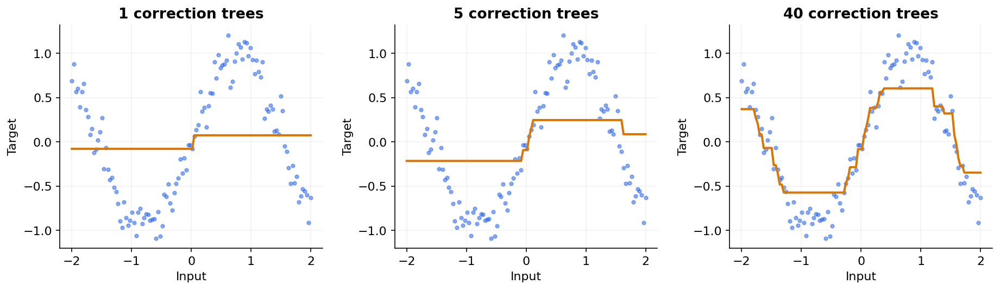

# 17 — Gradient boosting, XGBoost, LightGBM and CatBoost

[Course map](README.md) · [Practicals](../02-practicals/README.md) · [Questions and answers](../03-questions-and-answers/worked-questions.md#lesson-17)

## On this page

- [Build the next tree to improve the current prediction](#build-the-next-tree-to-improve-the-current-prediction)
- [Second-order boosted trees](#second-order-boosted-trees)

## Build the next tree to improve the current prediction

Gradient boosting constructs $F_t(x)=F_{t-1}(x)+\eta h_t(x)$. At each round, fit a weak learner to a direction that reduces the current loss. The pseudo-residual is $r_{it}=-\partial\ell(y_i,F(x_i))/\partial F\vert_{F_{t-1}}$. For squared error it is the familiar residual $y_i-F_{t-1}(x_i)$; for other losses it is not generally the raw residual.

For targets $[2,4,6]$, begin with the mean 4. Residuals are $[-2,0,2]$. Suppose a simple tree groups the first two rows together and the last separately: leaf corrections are−1 and 2. At learning rate 0.5 the predictions become $[3.5,3.5,5]$. SSE falls from 8 to 3.5. The tree is an approximate gradient direction; another round works on the new residuals.

For binary log loss, boosting often works with log odds, whose sigmoid becomes probability. Initial log odds can use class prevalence. Mixing probability-scale residuals and logit-scale updates without a defined derivation gives incorrect calculations.

## Second-order boosted trees

XGBoost uses an objective containing prediction loss and tree complexity. In a common derivation let leaf gradient sum be $G$, Hessian sum $H$, L 2 leaf penalty $\lambda$ and per-leaf penalty $\gamma$. The optimal leaf score is $-G/(H+\lambda)$. A split's gain is

$$\frac12\left[\frac{G_L^2}{H_L+\lambda}+\frac{G_R^2}{H_R+\lambda}-\frac{G^2}{H+\lambda}\right]-\gamma.$$

For squared error, gradients are $F-y$ and Hessians 1. A leaf with residuals $[2,4]$ has $G=-6,H=2$; with $\lambda=1$ its score is 2, versus unpenalized mean residual 3. This is a specific objective convention; implementation options can add further constraints. [XGBoost's derivation](https://xgboost.readthedocs.io/en/stable/tutorials/model.html) explains these leaf and split terms.

| Family | Main design idea | Practical caution |
|---|---|---|
| Classical gradient boosting | Sequential trees fit loss gradients | Can be slow for large tables |
| Histogram boosting | Bin numeric values to accelerate splits | Bin resolution and leaf constraints matter |
| XGBoost | Regularized boosted trees with efficient training options | Validate objective, missing-value and categorical settings |
| LightGBM | Efficient histogram methods and leaf-wise growth | Leaf-wise complexity needs min-leaf/depth control |
| CatBoost | Ordered learning techniques and categorical handling | Native category handling is not permission for target leakage |

[LightGBM documents its histogram and leaf-wise design](https://lightgbm.readthedocs.io/en/stable/Features.html); categorical handling and ordered learning are described in the [CatBoost concepts guide](https://catboost.ai/docs/en/concepts/).

Tune learning rate with tree count/early stopping; tree depth or leaf count; min leaf/Hessian constraints; row/column subsampling; regularization and class weighting. Use a separate development validation set for early stopping, then evaluate on untouched test data. Trees normally need no scaling, but category encodings, missingness and time-safe features still matter. Advantages are strong tabular nonlinear fits and many supported objectives; disadvantages include sequential training, tuning complexity and weak outside-range regression extrapolation. Inspect errors, probabilities and serving cost, not only leaderboard score.

---

[← 16: AdaBoost: learning from weighted mistakes](16-adaboost.md) · [18: Voting, stacking and blending →](18-voting-and-stacking.md)
