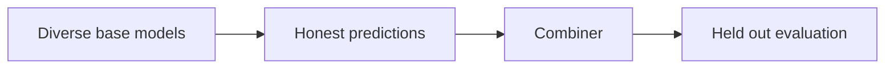
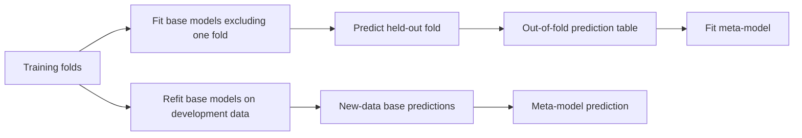

# 18 — Voting, stacking and blending

[Course map](README.md) · [Practicals](../02-practicals/README.md) · [Questions and answers](../03-questions-and-answers/worked-questions.md#lesson-18)

## On this page

- [Combine complementary models honestly](#combine-complementary-models-honestly)
- [Why in-sample stacking cheats](#why-in-sample-stacking-cheats)

## Combine complementary models honestly

Hard voting chooses a class by votes; soft voting averages estimated class probabilities; regression averaging combines numeric outputs. The useful ingredient is complementary held-out errors, not merely many models. Five names trained on the same leakage can agree for the wrong reason. Probability scales and class order must align before averaging.

For two classifiers producing positive probabilities 0.8 and 0.4, equal soft voting gives 0.6. At threshold 0.5 it predicts positive. A hard vote may tie if one predicts positive and the other negative. Define a tie rule rather than letting library class ordering silently decide an important business outcome.

Stacking trains a second-level model on base-model predictions. Its most important rule is **out-of-fold training predictions**: each training row's meta-features must be generated by a base model that did not train on that row.

## Why in-sample stacking cheats

A deep tree may predict its training labels perfectly. A meta-model trained on these in-sample predictions learns that the tree is unbeatable, although it may fail on unseen observations. Out-of-fold predictions recreate the uncertainty the meta-model will face at serving time. For time/group problems, the out-of-fold procedure must respect time/groups too.

Blending fits the combiner on one separate holdout instead of a full out-of-fold table. It is simpler but consumes data and can depend strongly on that one split. Selecting base models, weights and meta-model complexity is still model selection, requiring outer validation or a final untouched test.

| Method | Fit / objective | Pros | Cons |
|---|---|---|---|
| Fixed averaging | Prespecified weights sum to 1 | Simple, low extra variance | Poor models can dilute good ones |
| Learned weighted average | Minimize development loss subject to chosen constraints | Adapts contributions | Overfits if weights use too little data |
| Stacking | Meta-model loss on OOF base outputs | Learns complementary behaviour | Extra training, serving and leakage risk |

Tune base diversity, weighting, regularization and the meta-model. A linear regularized combiner often provides a sensible starting point. For classification, compare probability calibration after combination; averaging is not proof of calibration. Include inference time, memory and maintenance burden in the decision: a tiny metric gain may not justify serving several expensive pipelines.

---

[← 17: Gradient boosting, XGBoost, LightGBM and CatBoost](17-gradient-boosting.md) · [19: K-means, k-means++, mini-batch and k-medoids →](19-centroid-clustering.md)
