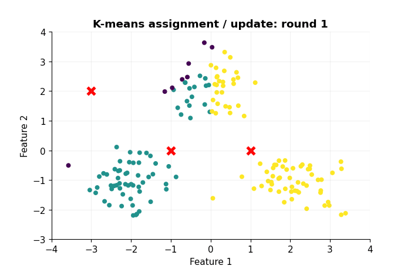

# 19 — K-means, k-means++, mini-batch and k-medoids

[Course map](README.md) · [Practicals](../02-practicals/README.md) · [Questions and answers](../03-questions-and-answers/worked-questions.md#lesson-19)

## On this page

- [Find groups around representative centres](#find-groups-around-representative-centres)
- [Variants and choices](#variants-and-choices)
- [Evaluate the grouping](#evaluate-the-grouping)

## Find groups around representative centres

Clustering has no target labels in its training objective. K-means assigns observations to $k$ centres and minimizes within-cluster sum of squared Euclidean distances:

$$J=\sum_i\|x_i-\mu_{c_i}\|_2^2.$$

Lloyd's algorithm alternates assignment to the nearest centre and recomputation of each centre as the mean of assigned observations. Each exact step cannot increase this objective, but it can settle at a local optimum. Choosing $k$ and initialization matters. A cluster number is just an identifier; cluster 0 is not inherently “low value”.

For 1D data $[1,2,8,9]$ and initial centres 1,8, assignment gives $[1,2]$ and $[8,9]$. Updated centres are 1.5,8.5. WCSS is $0.25+0.25+0.25+0.25=1$. A single centre 5 gives $16+9+9+16=50$. Adding centres always reduces or preserves optimal WCSS; choosing $k=n$ would give 0 but is not a useful segmentation.

## Variants and choices

| Method | What changes? | Use / limitation |
|---|---|---|
| K-means++ initialization | Samples seeds favouring squared distance from existing seeds | Often better starts; still use suitable restarts |
| Mini-batch k-means | Updates from small batches | Scales better; approximate, noisy optimization |
| K-medoids | Representatives are actual observations; minimizes chosen dissimilarities | Useful non-Euclidean distances, generally costlier |
| Spherical k-means | Direction-based normalized representation | Useful for some text-like similarities; not ordinary Euclidean k-means |

Standardize relevant numeric features and justify their weights. One-hot mixed data can make Euclidean distance hard to interpret; do not pretend category codes are continuous measurements. K-means favours compact approximately spherical clusters and is sensitive to outliers, unequal densities and elongated groups.

## Evaluate the grouping

The elbow is a visual heuristic, not a mathematical proof of the correct $k$. Silhouette for observation $i$ is $(b_i-a_i)/\max(a_i,b_i)$, where $a_i$ is average within-cluster distance and $b_i$ is the smallest average distance to another cluster. It is undefined for certain degenerate clusterings and can favour particular geometries. If $a=1,b=4$, silhouette 0.75suggests the point is nearer its own group.

The Dunn index is the minimum inter-cluster separation divided by maximum within-cluster diameter under a specified distance convention. A larger value suggests compact, separated groups, but extremes and distance definitions strongly affect it. Like silhouette, it is an internal geometric measure, not proof of meaningful categories.

Compare stability under resampling, domain meaning and downstream usefulness. If true labels are available only for evaluation, adjusted Rand index or adjusted mutual information measures agreement without equating numeric cluster IDs. A high silhouette does not establish useful customer personas. Profile clusters using features not merely the chosen ID, and check sensitive-variable implications before using segments for decisions.

---

[← 18: Voting, stacking and blending](18-voting-and-stacking.md) · [20: Hierarchical clustering and BIRCH →](20-hierarchical-clustering.md)
