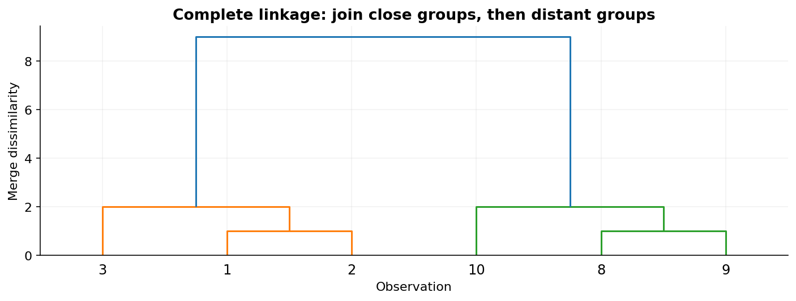

# 20 — Hierarchical clustering and BIRCH

[Course map](README.md) · [Practicals](../02-practicals/README.md) · [Questions and answers](../03-questions-and-answers/worked-questions.md#lesson-20)

## On this page

- [Build a family tree of groups](#build-a-family-tree-of-groups)
- [Training, use and limitations](#training-use-and-limitations)
- [BIRCH for larger numeric datasets](#birch-for-larger-numeric-datasets)

## Build a family tree of groups

Agglomerative clustering starts with individual observations and repeatedly merges the closest groups. A dendrogram shows merge order and merge dissimilarity. Cutting the tree at a height yields a flat grouping. Divisive clustering works in the opposite direction, recursively splitting groups. Neither requires that a single flat $k$ be chosen at the beginning, although a final flat grouping still needs a cut rule.

| Linkage | Distance between groups | Behaviour |
|---|---|---|
| Single | Closest pair | Can connect groups through thin chains |
| Complete | Farthest pair | Favours compact groups; sensitive to extremes |
| Average | Mean pairwise distance | Compromise between chaining and compactness |
| Ward | Increase in within-group squared error | Variance-based; requires Euclidean geometry |

For groups $A=[1,2]$ and $B=[8,9]$, single linkage distance 6, complete 8 and average 7. Ward's increase is $\frac{n_An_B}{n_A+n_B}\|\mu_A-\mu_B\|^2=(4/4)7^2=49$. Different criteria therefore encode different definitions of a good group. Do not use an arbitrary distance matrix with Ward and assume its variance interpretation still holds.

## Training, use and limitations

There is no single universal loss shared by all linkages. The algorithm greedily applies its merge criterion; it does not backtrack to optimize every possible hierarchy. Standardize when numeric scales should carry comparable weight. Tune linkage, distance, connectivity constraints and cut threshold or number of clusters. Once an early merge is made, a later stage cannot undo it in standard agglomeration.

The hierarchy is helpful for exploring related documents, gene profiles or product families. Pairwise distances can require quadratic memory and become expensive on large datasets. A dendrogram with thousands of leaves is often unreadable; truncate or summarize and keep labels honest. Many hierarchical implementations do not directly provide prediction for new points; define an assignment strategy separately instead of silently refitting and expecting identical cluster IDs.

## BIRCH for larger numeric datasets

BIRCH compresses observations into a clustering-feature tree using summaries such as count, linear sum and squared sum, then clusters the compact representation. Threshold and branching factor control compression. It can be useful for incremental or large numeric data, but sensitivity to scale, arrival order and high dimensionality still matters. It is not a drop-in equivalent to every full pairwise hierarchy.

Evaluate stability, silhouette with its geometric caveats and domain usefulness. Compare a hierarchy with k-means if compact groups are plausible, and density methods if irregular shapes and noise dominate. The tree's visual appeal is an aid to interpretation, not evidence that nature contains exactly those categories.

---

[← 19: K-means, k-means++, mini-batch and k-medoids](19-centroid-clustering.md) · [21: DBSCAN, OPTICS and HDBSCAN →](21-density-clustering.md)
