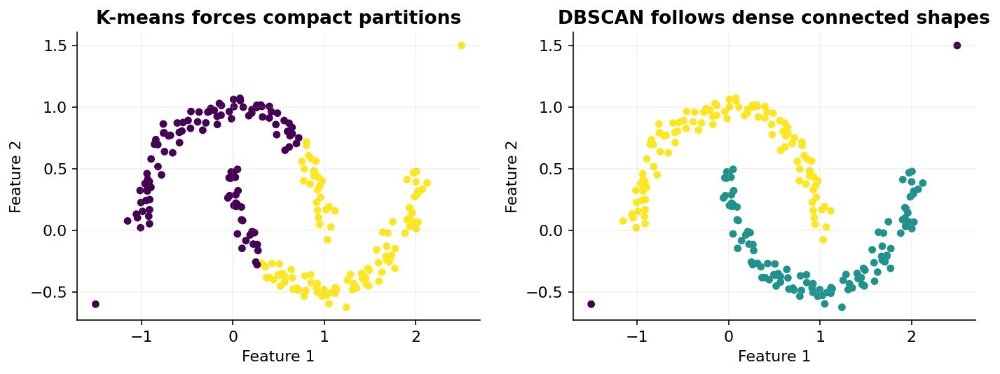

# 21 — DBSCAN, OPTICS and HDBSCAN

[Course map](README.md) · [Practicals](../02-practicals/README.md) · [Questions and answers](../03-questions-and-answers/worked-questions.md#lesson-21)

## On this page

- [A cluster can be a dense connected region](#a-cluster-can-be-a-dense-connected-region)
- [Related algorithms](#related-algorithms)
- [When to use it](#when-to-use-it)

## A cluster can be a dense connected region

K-means struggles with curved shapes and forces every observation into a group. DBSCAN instead defines a neighbourhood radius $\epsilon$ and minimum number of samples. A **core** point has enough neighbours within $\epsilon$; a **border** point is reachable from a core point but is not itself core; other points are noise. In scikit-learn's convention the point itself counts in `min_samples`.

With 1D points $[0,0.1,0.2,3]$, $\epsilon=0.15$ and min_samples 3, point 0.1 is core because it sees all of 0,0.1,0.2. Points 0 and 0.2 are border;3 is noise. Border membership can be ambiguous if a point is reachable from multiple components; implementation ordering can affect that assignment. Density-connected core structure is the key, not an imaginary centroid.

DBSCAN grows connected dense regions rather than minimizing k-means WCSS. The distance metric and feature scaling define density. Tune radius, minimum support and representation; inspect k-neighbour distances as a heuristic, not as an automatic universal solution.

## Related algorithms

| Method | Main idea | What to watch |
|---|---|---|
| DBSCAN | One radius and density threshold | One radius may fail when cluster densities differ |
| OPTICS | Orders points and records density reachability structure | Extraction choices still affect flat clusters |
| HDBSCAN | Builds a hierarchy over density scales and selects stable clusters | Min cluster size/support and metric still require care |
| Mean shift | Moves points toward modes of a kernel-density estimate | Bandwidth and computation can dominate |

OPTICS is useful for inspecting density structure across radii; HDBSCAN can handle differing density scales better than a single DBSCAN radius in many datasets, but neither guarantees a semantically correct partition. Noise labels mean “not assigned under this density rule,” not necessarily fraud or bad data.

## When to use it

Geographic events, spatial anomalies and irregular groups are natural candidates when the chosen distance is meaningful. Use a geographic distance if coordinates require it; raw latitude/longitude Euclidean distances may be inappropriate over large areas. High dimension makes neighbourhood density hard to estimate and can make distance search expensive. Some implementations can materialize large neighbourhood structures with high memory use.

Evaluate the number of assigned/noise observations, stability, meaningful shapes and any labelled external agreement. Excluding noise before computing silhouette can make a result look better by ignoring difficult cases, so report the noise proportion alongside the score. For new observations, a density-clustering implementation may not have a standard `predict`; explicitly define out-of-sample behaviour. Do not confuse clustering training with a supervised anomaly detector trained on known fraud labels.

---

[← 20: Hierarchical clustering and BIRCH](20-hierarchical-clustering.md) · [22: Gaussian mixtures, EM and density estimation →](22-mixtures-and-em.md)
