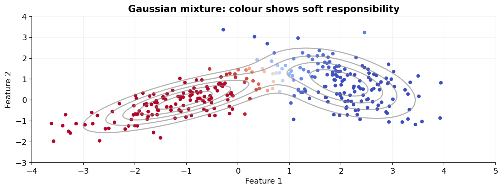

# 22 — Gaussian mixtures, EM and density estimation

[Course map](README.md) · [Practicals](../02-practicals/README.md) · [Questions and answers](../03-questions-and-answers/worked-questions.md#lesson-22)

## On this page

- [Allow uncertain membership](#allow-uncertain-membership)
- [Expectation–maximization](#expectationmaximization)
- [Other density models](#other-density-models)

## Allow uncertain membership

A Gaussian mixture models $p(x)=\sum_{k=1}^K\pi_k\mathcal N(x;\mu_k,\Sigma_k)$, with nonnegative mixing weights summing to 1. Unlike hard k-means assignments, each point has responsibilities $r_{ik}=P(component=k\mid x_i)$. Full covariance permits ellipses with different orientations; diagonal, tied and spherical variants trade flexibility for fewer parameters.

Two components with equal priors, means 0 and 2 and variance 1give equal responsibilities at $x=1$. At $x=0$, unnormalized densities are proportional to 1 and $e^{-2}$, giving responsibility $1/(1+e^{-2})\approx0.8808$ for the first component. A component is a statistical density term; it is not automatically a real business category.

## Expectation–maximization

The objective is log likelihood $\sum_i\log\sum_k\pi_k\mathcal N(x_i;\mu_k,\Sigma_k)$. EM alternates:

1. **E-step:** compute responsibilities using current parameters.
2. **M-step:** update $N_k=\sum_i r_{ik}$,$\pi_k=N_k/n$,$\mu_k=\sum_i r_{ik}x_i/N_k$, and responsibility-weighted covariances.
3. Repeat until a specified convergence tolerance or iteration limit.

Exact EM steps do not decrease likelihood, but can converge to local optima. A Gaussian component can collapse onto a point and make unregularized likelihood unbounded. Covariance regularization and initialization are important, not cosmetic.

Tune component count, covariance structure, regularization and restarts. AIC is $2q-2\log\hat L$ and BIC is $q\log n-2\log\hat L$, where $q$ is parameter count. They balance fit with complexity under assumptions; compare them on the same observations and be aware mixture-model regularity can be subtle. Held-out likelihood evaluates density fit; external labels or domain review evaluate segmentation.

## Other density models

Kernel density estimation averages kernels centred on observations. Its bandwidth controls smoothness; small bandwidth produces spiky fits, large bandwidth oversmooths. It can be useful in low dimension but becomes data-hungry in high dimension. Bayesian mixtures put priors on components/weights and use approximate inference; a truncation or prior still imposes modelling choices.

**Advantages:** soft membership, elliptical clusters, explicit density and likelihood. **Limitations:** distributional mismatch, local optima, covariance estimation cost, numerical degeneracy and weak high-dimensional density estimates without sufficient data. Use k-means for a simpler compact grouping; use density clustering for arbitrary dense shapes with noise. A low density point is unusual under the fitted distribution, which need not mean harmful or erroneous.

---

[← 21: DBSCAN, OPTICS and HDBSCAN](21-density-clustering.md) · [23: PCA, SVD, NMF, ICA and cross-decomposition →](23-linear-dimension-reduction.md)
