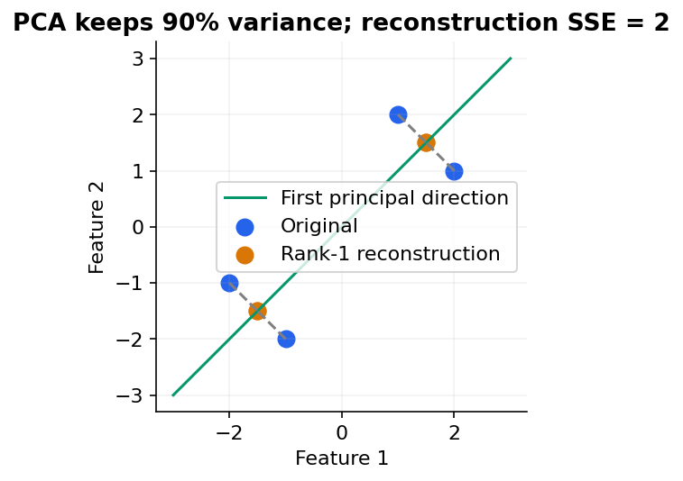

# 23 — PCA, SVD, NMF, ICA and cross-decomposition

[Course map](README.md) · [Practicals](../02-practicals/README.md) · [Questions and answers](../03-questions-and-answers/worked-questions.md#lesson-23)

## On this page

- [Replace many coordinates with a useful few](#replace-many-coordinates-with-a-useful-few)
- [Exact worked example](#exact-worked-example)

## Replace many coordinates with a useful few

PCA finds orthogonal directions of greatest variance in centred data. The first component maximizes projected variance; later ones are orthogonal and explain remaining variance. Equivalently it gives the best rank-$k$ linear reconstruction under squared error. It ignores target labels: a low-variance direction can still be highly predictive.

For centred $X$, covariance is $C=X^TX/(n-1)$. Its eigenvectors are component directions and eigenvalues their sample variances. With SVD $X=USV^T$, the columns of $V$ are principal directions and eigenvalues are $s_j^2/(n-1)$. Sign flips of a component are mathematically equivalent.

## Exact worked example

Take rows $(-2,-1),(-1,-2),(1,2),(2,1)$. Means are 0 and

$$C=\begin{bmatrix}10/3&8/3\\8/3&10/3\end{bmatrix}.$$

Eigenvalues are 6 and $2/3$. The first direction is $(1,1)/\sqrt2$ and explains $6/(6+2/3)=90\%$ of variance. The first point projects to $-3/\sqrt2$ and reconstructs as $(-1.5,-1.5)$ using one component. Every row loses squared error 0.5, total 2. This equals the discarded singular value squared. Reconstruction is approximate, not recovered original data.

Scale before PCA if unit differences should not determine importance; otherwise preserve meaningful original units. Fit PCA only on training folds. Whitening rescales components to unit variance and can amplify small-variance noise. Tune retained components through downstream validation or an explicit reconstruction requirement, not automatically 95%variance.

| Method | Objective / training | Suitable use | Limitation |
|---|---|---|---|
| Truncated SVD | Low-rank approximation, often without centering | Sparse text matrices | Not identical to centred PCA |
| NMF | Approximate nonnegative $X\approx WH$ using squared or selected divergence loss | Additive parts/topics | Nonconvex; requires nonnegative input |
| ICA | Seek statistically independent latent sources | Source separation | Assumptions/scale/order ambiguity |
| Factor analysis | Latent linear factors plus explicit noise model | Shared latent variation | Distribution/identifiability assumptions |
| PLS | Supervised latent directions linking $X$ and $Y$ | Collinear predictors | Must fit within CV because it uses targets |
| CCA | Maximize correlation between projected variable sets | Relate two views | High-dimensional estimates need regularization |

PCA is fast and interpretable as a linear projection, but components can be hard to name and do not guarantee useful clusters or improved prediction. A good application compresses correlated measurements or denoises a low-rank signal; a poor one drops rare predictive signals purely because they explain little overall variance.

---

[← 22: Gaussian mixtures, EM and density estimation](22-mixtures-and-em.md) · [24: Kernel PCA, manifolds, t-SNE, UMAP and spectral methods →](24-manifolds-and-spectral-methods.md)
