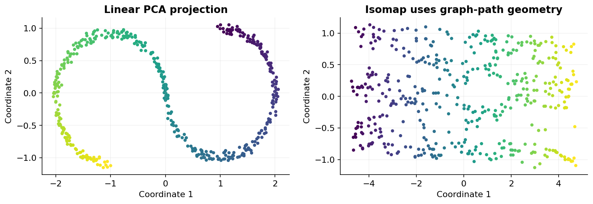

# 24 — Kernel PCA, manifolds, t-SNE, UMAP and spectral methods

[Course map](README.md) · [Practicals](../02-practicals/README.md) · [Questions and answers](../03-questions-and-answers/worked-questions.md#lesson-24)

## On this page

- [Reveal structure without trusting every picture](#reveal-structure-without-trusting-every-picture)
- [Understand a graph-based method](#understand-a-graph-based-method)
- [Use visualizations responsibly](#use-visualizations-responsibly)

## Reveal structure without trusting every picture

Linear projections cannot unfold every curved surface. Nonlinear representation methods preserve a selected relationship such as neighbourhoods, geodesic paths or kernel similarity. A2Dplot is a projection chosen by an objective, not a direct photograph of the true structure. Different settings can give different pictures.

| Method | Main training idea | Key settings | Appropriate caution |
|---|---|---|---|
| Kernel PCA | PCA in a kernel-defined feature space using a centred kernel matrix | Kernel, gamma, components | Kernel matrix cost; inverse mapping is not automatic |
| Isomap | Preserve estimated graph geodesic distances | Neighbour count, metric | Disconnected or shortcut edges distort geometry |
| Locally linear embedding | Preserve local reconstruction weights | Neighbours, regularization | Sensitive to neighbourhood choice and noise |
| Multidimensional scaling | Match given dissimilarities with low-dimensional distances | Metric/nonmetric stress, initialization | Expensive and potentially locally optimized |
| t-SNE | Minimize KL divergence between neighbourhood probability distributions | Perplexity, learning rate, initialization | Global gaps and apparent cluster sizes are not reliable evidence |
| UMAP | Optimize a low-dimensional fuzzy-neighbourhood representation | Neighbours, minimum distance, metric | Distances/shape depend on settings; clusters need validation |
| Spectral embedding | Use eigenvectors of a graph Laplacian | Affinity, neighbourhoods, components | Graph construction defines the result |

## Understand a graph-based method

Build a similarity graph: observations are nodes, strong similarity gives strong edges. A Laplacian is $L=D-W$, with edge matrix $W$ and degree diagonal $D$. Normalized variants account for node degree. Spectral clustering embeds points using selected Laplacian eigenvectors, then often applies k-means. It can separate curved groups where raw-space k-means fails, but needs an appropriate affinity and often a specified cluster count.

Suppose six points form two tight triangles far apart. A good local-neighbour graph has strong within-triangle edges and few across-triangle edges. Its spectrum helps identify the near-disconnection. A fully connected graph with poorly scaled similarity can erase that structure. The graph is a modelling decision, not a neutral preprocessing step.

## Use visualizations responsibly

Repeat with different seeds and neighbourhood settings. Colour by known labels only after fitting unsupervised structure, and separately test whether any supervised pipeline improves held-out performance. Never choose the model solely because a t-SNE plot has attractive islands. Distances between distant islands, their occupied area and empty space can be artifacts of the visualization objective.

Some methods have no standard efficient out-of-sample transform; others do. This affects production use and train/test separation. Fit any learned transform on training data and use only supported out-of-sample behaviour. Random projection and random kernel features offer simpler scalable approximations when the goal is preserving distances or approximating kernels rather than an attractive 2Dmap.

**Checkpoint:** explain exactly which relationship the picture tries to preserve and which apparent properties it does not justify.

---

[← 23: PCA, SVD, NMF, ICA and cross-decomposition](23-linear-dimension-reduction.md) · [25: Anomaly, novelty and outlier detection →](25-anomaly-detection.md)
