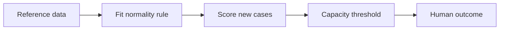
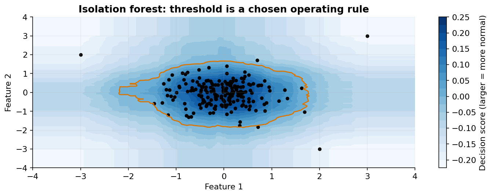

# 25 — Anomaly, novelty and outlier detection

[Course map](README.md) · [Practicals](../02-practicals/README.md) · [Questions and answers](../03-questions-and-answers/worked-questions.md#lesson-25)

## On this page

- [Unusual is not the same as harmful](#unusual-is-not-the-same-as-harmful)
- [Thresholds are part of the decision](#thresholds-are-part-of-the-decision)

## Unusual is not the same as harmful

Outlier detection finds atypical observations in a potentially contaminated dataset. Novelty detection learns a reference notion of normality and scores **new** examples. Supervised fraud classification uses known fraud labels and is a different setting. A rare valid transaction can be unusual but harmless; common coordinated fraud may not be geometrically rare.

| Algorithm | Score / training principle | Suitable pattern | Main limitation |
|---|---|---|---|
| Isolation forest | Random splits isolate unusual examples in shorter paths | Large tabular anomaly screening | Definition depends on representation and axis-aligned partitioning |
| Local outlier factor | Compare local density with neighbours | Locally unusual points amid variable density | Neighbour count/scale; novelty mode must be configured correctly |
| One-class SVM | Kernel boundary around reference distribution | Moderate-size scaled normal data | Kernel tuning and computation |
| Robust covariance / elliptic envelope | Robust location/covariance, Mahalanobis distance | Roughly ellipsoidal reference data | Strong shape assumptions; high dimensions need care |
| Reconstruction models | Large autoencoder/PCA reconstruction error | Off-manifold deviations | Can reconstruct anomalies too; misses some in-manifold changes |

Isolation forest normalizes average path length into a score; shorter paths mean easier isolation. LOF compares a point's local reachability density with its neighbours': a much lower density yields a larger outlier factor. An example in a sparse but coherent group may be normal locally even if far from the global mean.

## Thresholds are part of the decision

An anomaly score orders unusualness; a threshold selects alerts. A `contamination` setting often controls the expected flagged fraction or decision threshold, not a magical discovery of the true fraud rate. Score sign conventions differ between methods and APIs: verify whether larger means more normal or more anomalous before ranking alerts.

If analysts can review 50 cases daily, assess precision@50, recall where labelled coverage exists and time-to-detection. Precision estimated only from reviewed top alerts may not describe all transactions. Random audit samples or delayed outcome labels can help measure missed events. With no labels, use domain investigation, injected realistic anomalies with explicit limitations, stability and reference-distribution checks; silhouette is not an anomaly metric.

Scale and encode meaningfully, exclude obvious identifiers, and fit on the appropriate reference time window. Tune neighbourhood size, kernel parameters or tree subsampling through a realistic validation design. Revisit thresholds under drift. Automatic deletion of outliers is risky for modelling: an extreme target may be a valid high-value customer or precisely the event the model needs to predict.

**Practical scenario:** combine an anomaly ranking with a human-review workflow. Log why alerts were generated and review outcomes. Treat the detector as a prioritization aid until its relationship to the actual harmful event has been measured.

---

[← 24: Kernel PCA, manifolds, t-SNE, UMAP and spectral methods](24-manifolds-and-spectral-methods.md) · [26: Feature selection, imbalanced learning and label quality →](26-feature-selection-and-imbalance.md)
