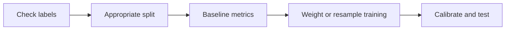
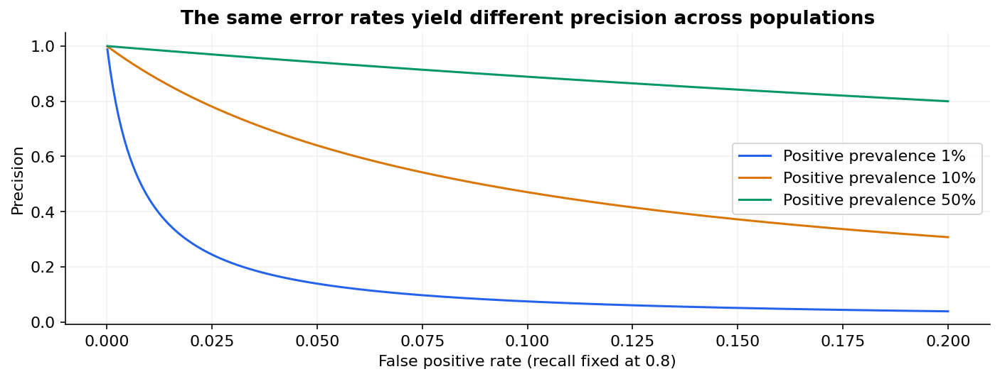

# 26 — Feature selection, imbalanced learning and label quality

[Course map](README.md) · [Practicals](../02-practicals/README.md) · [Questions and answers](../03-questions-and-answers/worked-questions.md#lesson-26)

## On this page

- [More columns and more positives are not automatically better](#more-columns-and-more-positives-are-not-automatically-better)
- [Reweight, resample or change the decision?](#reweight-resample-or-change-the-decision)

## More columns and more positives are not automatically better

Feature selection retains a subset of inputs; feature extraction creates new coordinates. Filters use quantities such as variance, univariate association or mutual information. Wrappers evaluate subsets through a model, as in recursive feature elimination. Embedded selection happens during training, as in L1 penalties. Selection using labels belongs **inside training folds**, including apparently simple correlation screening.

| Method | Why use it? | Risk |
|---|---|---|
| Filter | Fast, useful initial reduction | Misses interactions; multiple-testing optimism |
| RFE / sequential selection | Tailored to estimator | Expensive; unstable among correlated inputs |
| L1 / elastic net | Fits and selects together | Scale and correlation affect choice |
| Held-out permutation importance | Measure score drop after disturbing a feature | Correlated alternatives can mask importance |

Imbalance is a property of class proportions; the practical problem is often unequal error costs, limited minority coverage or a poor threshold. A1%positive class can still be easy if features cleanly separate it. A balanced 50:50task can still be difficult. Start with a relevant split, suitable metrics and enough positive examples to estimate recall reliably.

## Reweight, resample or change the decision?

Class weighting changes training loss, for example $J=\sum_i a_{y_i}\ell_i/\sum_i a_{y_i}$. Random undersampling reduces majority data and can discard useful variation; oversampling repeats minority evidence but adds no independent information. SMOTE interpolates minority neighbours; it must run only within training folds and requires appropriate treatment of categories and geometry. Synthetic points are not new verified real-world events.

Threshold adjustment changes the operating point without necessarily changing score ranking. Often this is the first step if the model already ranks well. Resampling and class weighting can distort probabilities relative to deployment prevalence, so recalibrate or adjust under justified assumptions and evaluate on naturally distributed validation/test data.

**Example:** train on a rebalanced 50:50sample, but deploy at 1%prevalence. A probability 0.8 from the rebalanced task is not automatically an 80%real-world fraud chance. Keep a representative calibration/evaluation sample and document the sampling design.

Label errors also matter. Review high-loss cases, disagreement and duplicates; use domain verification before “fixing” labels. Positive–unlabelled learning assumes unlabelled observations may contain positives, unlike treating them all as confirmed negatives. Delayed fraud outcomes can create false negatives if the label window is too short. Prefer careful target construction to ever more aggressive resampling.

---

[← 25: Anomaly, novelty and outlier detection](25-anomaly-detection.md) · [27: Bayesian learning and Gaussian processes →](27-bayesian-learning-and-gaussian-processes.md)
