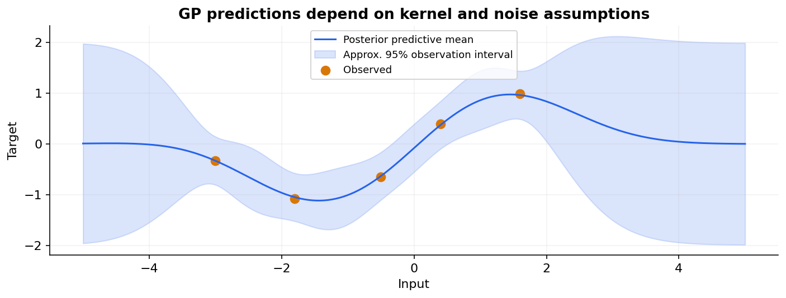

# 27 — Bayesian learning and Gaussian processes

[Course map](README.md) · [Practicals](../02-practicals/README.md) · [Questions and answers](../03-questions-and-answers/worked-questions.md#lesson-27)

## On this page

- [Learn a distribution rather than only one estimate](#learn-a-distribution-rather-than-only-one-estimate)
- [Gaussian processes: similarity defines a distribution over functions](#gaussian-processes-similarity-defines-a-distribution-over-functions)
- [Fit and compare](#fit-and-compare)

## Learn a distribution rather than only one estimate

Bayesian inference updates $p(\theta|D)\propto p(D|\theta)p(\theta)$. A prior expresses assumptions before observing this dataset; the likelihood connects parameters to observations; the posterior combines them. Prediction averages over parameter uncertainty: $p(y_*|x_*,D)=\int p(y_*|x_*,\theta)p(\theta|D)d\theta$. A maximum-a-posteriori estimate uses the posterior mode instead and is not the same as full posterior prediction.

With a Beta(1,1)prior on a binary event probability and 7 successes,3 failures, the posterior isBeta(8,4). Its mean is $8/12=2/3$, compared with empirical 7/10. The prior's effect weakens as reliable evidence grows. Priors cannot rescue an incorrect sampling model, and posterior uncertainty is conditional on modelling assumptions.

## Gaussian processes: similarity defines a distribution over functions

A GP specifies a mean function and kernel $k(x,z)$ that describes how outputs co-vary. Nearby inputs under an RBF kernel have strongly related function values. For Gaussian observation noise variance $\sigma_n^2$, training covariance is $K+\sigma_n^2I$. With zero prior mean,

$$m_* = k_*^T(K+\sigma_n^2I)^{-1}y,$$
$$v_* = k(x_*,x_*)-k_*^T(K+\sigma_n^2I)^{-1}k_*.$$

This is latent-function variance; predictive observation variance also includes observation noise. Use linear solves, not explicit inverses in implementation.

For one observation $x=0,y=1$, kernel self-variance 1 and noise variance 0.25, posterior mean at 0 is $1/1.25=0.8$, latent variance $1-1/1.25=0.2$. At a very distant point with negligible kernel similarity, mean approaches the prior mean 0 and variance approaches 1. This behaviour is dictated by the kernel; it is not guaranteed knowledge about all real-world uncertainty.

## Fit and compare

GP regression commonly optimizes log marginal likelihood over kernel/noise parameters. Tune kernel family, length scales, signal/noise levels and normalization. Exact dense training typically requires cubic time and quadratic memory in the number of observations; sparse/inducing-point approximations address scale. GP classification needs approximate inference because the Bernoulli likelihood is not conjugate to the Gaussian prior.

Use GPs for smaller smooth-function datasets, uncertainty-aware regression or Bayesian optimization. Compare ridge/kernel ridge when a point predictor is enough, and boosted trees for large heterogeneous tables. Bayesian optimization uses a surrogate and acquisition function to choose evaluations under a budget; it is a search strategy, not the same thing as GP regression itself. Assess predictive accuracy **and** interval calibration; a confident posterior can still be wrong under misspecification or shift.

---

[← 26: Feature selection, imbalanced learning and label quality](26-feature-selection-and-imbalance.md) · [28: Recommendation, matrix factorization and ranking →](28-recommendation-and-ranking.md)
