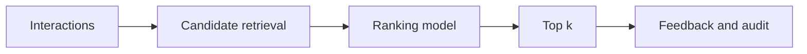
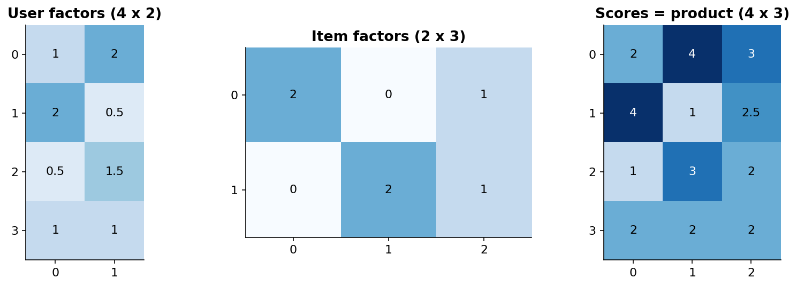

# 28 — Recommendation, matrix factorization and ranking

[Course map](README.md) · [Practicals](../02-practicals/README.md) · [Questions and answers](../03-questions-and-answers/worked-questions.md#lesson-28)

## On this page

- [Predict preference or order items](#predict-preference-or-order-items)
- [Pointwise, pairwise and listwise learning](#pointwise-pairwise-and-listwise-learning)

## Predict preference or order items

A recommender may rank items for each user rather than classify each item independently. Explicit feedback includes ratings; implicit feedback includes clicks, plays and purchases. No click is not necessarily dislike: the item may never have been shown. Exposure and position bias affect what gets observed.

| Family | Learning idea | Strength | Limitation |
|---|---|---|---|
| Popularity / rules | Rank by a defined historical statistic | Strong cheap baseline | Weak personalization |
| Content-based | Match user/item features | Helps new items with useful metadata | Limited beyond observed content patterns |
| Neighbour collaborative filtering | Use similar users/items | Simple preference patterns | Sparse/cold-start data |
| Matrix factorization | Low-rank user/item embeddings | Captures latent tastes | New IDs need a strategy |
| Factorization machines | Pairwise factorized feature interactions | Sparse contextual tabular interactions | Objective and feature quality matter |
| Two-tower retrieval | Learn compatible user/item representations | Scalable candidate retrieval | Training negatives and exposure assumptions |

For ratings, predict $\hat r_{ui}=\mu+b_u+b_i+p_u^Tq_i$ and minimize observed squared errors plus regularization. Alternating least squares fixes item factors while fitting users, then reverses; SGD updates factors from sampled observations. Implicit-feedback ALS uses a confidence-weighted preference objective; it is not ordinary observed-rating regression with missing entries replaced uncritically by zero.

Example: user factor $(1,2)$ and item factors $A=(2,0),B=(0,2)$ give scores 2 and 4, soB ranks higher before biases. The coordinate meanings need not correspond to human-labelled “genres”; factorization has rotation/identifiability ambiguities.

## Pointwise, pairwise and listwise learning

Pointwise models predict each label/rating. Pairwise methods prefer a positive item over a negative; BPR uses $-\log\sigma(s_{ui^+}-s_{ui^-})$ plus regularization. Listwise methods optimize a distribution or surrogate over an entire ranked list. Learning-to-rank tree systems such as LambdaMART use ranking-related gradient constructions. Evaluation should match ranking, not just rating RMSE.

Precision@k measures relevant fraction in top $k$; recall@k measures retrieved fraction of relevant items. DCG discounts lower ranks, commonly $\sum_{j=1}^k(2^{rel_j}-1)/\log_2(j+1)$; NDCG divides by the ideal list's DCG using the same convention. If relevance $[1,0,1]$ is binary, DCG@3 is 1.5; ideal $[1,1,0]$ is $1+1/\log_2 3\approx1.63093$, soNDCG≈0.9197.

Use chronological and appropriate user/item splits; define cold-start evaluation. Negative sampling changes the task and can inflate offline metrics. Audit popularity bias, diversity, coverage, feedback loops and repeated exposure. A good recommender often separates candidate retrieval from reranking, then validates actual user value through a carefully designed online experiment.

---

[← 27: Bayesian learning and Gaussian processes](27-bayesian-learning-and-gaussian-processes.md) · [29: Association rules, Apriori and FP-growth →](29-association-rules.md)
