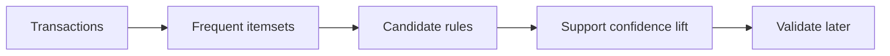
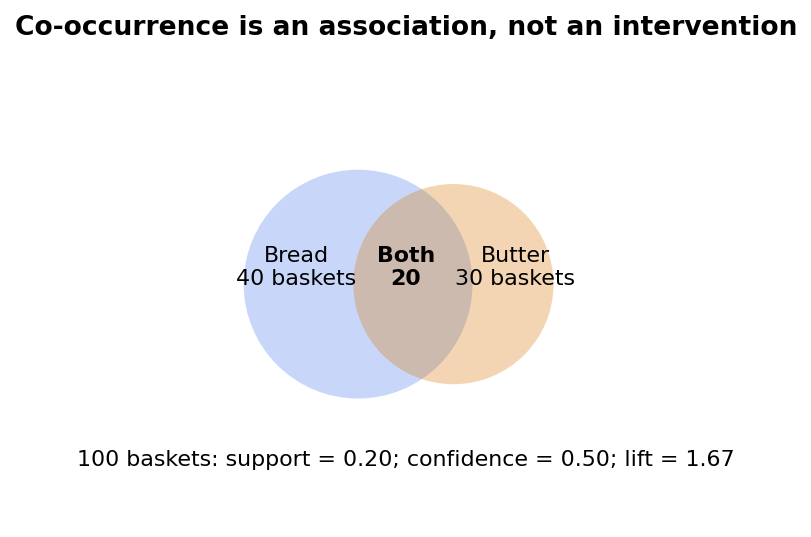

# 29 — Association rules, Apriori and FP-growth

[Course map](README.md) · [Practicals](../02-practicals/README.md) · [Questions and answers](../03-questions-and-answers/worked-questions.md#lesson-29)

## On this page

- [Discover co-occurrence, not supervised labels](#discover-co-occurrence-not-supervised-labels)
- [Calculate a basket rule](#calculate-a-basket-rule)
- [Algorithms and optimization](#algorithms-and-optimization)

## Discover co-occurrence, not supervised labels

Association mining asks which items tend to appear together in transactions. A rule $A\Rightarrow B$ does not mean buyingA causes buyingB. A transaction can contain several items; rule support and confidence summarize observed frequency, not an intervention.

$$support(A\Rightarrow B)=P(A\cup B),\quad confidence=P(B|A),\quad lift=\frac{P(B|A)}{P(B)}.$$

Here $A\cup B$ means a transaction contains all items in both itemsets, not a probability union of mutually exclusive events. Writing $P(A\text{ and }B)$ avoids that notational confusion. Leverage is $P(A,B)-P(A)P(B)$; conviction is $(1-P(B))/(1-confidence)$ when defined.

## Calculate a basket rule

Out of 100 baskets,40 contain bread,30 contain butter,20 contain both. Bread⇒butter has support 0.2, confidence $20/40=0.5$ and lift $0.5/0.3=1.667$. Butter⇒bread has confidence $20/30=0.667$ but the same lift. Confidence is directional; lift is symmetric for these two single-item events. A confidence of 90%can be uninteresting whenB appears in 95%of all baskets.

## Algorithms and optimization

Apriori uses the downward-closure property: an itemset cannot be frequent if one of its subsets is infrequent. It grows candidates level by level and prunes using minimum support. FP-growth compresses transactions into an FP-tree and recursively mines conditional patterns, reducing explicit candidate enumeration. Eclat uses vertical transaction-ID intersections. They mine patterns under support constraints, not a regression loss optimized by gradient descent.

Tune minimum support, confidence/lift filters, maximum itemset size and constraints on rule antecedents/consequents. Very low support can produce a combinatorial explosion of fragile rules. Very high support misses useful rare combinations. Adjust for repeated testing and use a later validation period; mining millions of rules guarantees some accidental impressive numbers.

**Suitable uses:** basket exploration, bundle hypotheses and process co-occurrence. **Limitations:** no causal direction, confounding, popularity effects, seasonal instability, privacy concerns for rare combinations and inability to infer preference for unseen offers. Recommend a bundle only after checking availability, margins and customer value; validate interventions with experiments rather than treating lift as guaranteed incremental sales.

Compare association mining with recommendation: rules describe observed item co-occurrence, while recommendation may use user context and optimize ranking. Both need time-safe transaction construction. A “basket” assembled using future purchases would leak information into an earlier recommendation decision.

---

[← 28: Recommendation, matrix factorization and ranking](28-recommendation-and-ranking.md) · [30: Semi-supervised, self-supervised, weak and active learning →](30-semi-self-and-weak-supervision.md)
