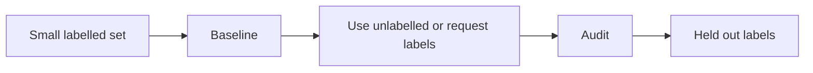

# 30 — Semi-supervised, self-supervised, weak and active learning

[Course map](README.md) · [Practicals](../02-practicals/README.md) · [Questions and answers](../03-questions-and-answers/worked-questions.md#lesson-30)

## On this page

- [Use unlabelled data without pretending it is free truth](#use-unlabelled-data-without-pretending-it-is-free-truth)
- [Active learning chooses what to label](#active-learning-chooses-what-to-label)

## Use unlabelled data without pretending it is free truth

Semi-supervised learning combines labelled and unlabelled examples. It helps only when structure in the unlabelled distribution relates to the target and the algorithm's assumptions are useful. More unlabelled data can hurt under distribution mismatch or incorrect pseudo-labels.

| Approach | Training signal | Typical objective / procedure | Risk |
|---|---|---|---|
| Self-training | Model's confident predictions | Add selected pseudo-labels, refit | Confirmation bias; overconfidence |
| Label propagation/spreading | Similarity graph and known labels | Smooth labels over graph with constraints/regularization | A wrong graph spreads wrong labels |
| Consistency regularization | Prediction stability under valid perturbations | Supervised loss plus agreement penalty | Perturbation may change the true label |
| Self-supervised masking | Hidden parts of inputs | Reconstruct/predict masked content | Pretraining data/objective mismatch |
| Contrastive learning | Positive and negative view relationships | Pull positives together, separate alternatives | False negatives and inappropriate augmentations |
| Weak supervision | Noisy heuristics, distant labels or imperfect sources | Combine/denoise label signals, then train | Correlated heuristics and systematic bias |

A common semi-supervised objective is $L=L_{labelled}+\lambda L_{unlabelled}$. The second term is not guaranteed useful just because it has many rows. A contrastive InfoNCE-style loss for a chosen positive pair is $-\log[\exp(sim(z_i,z_i^+)/\tau)/\sum_j\exp(sim(z_i,z_j)/\tau)]$, with the candidate set and positive convention defined explicitly. Temperature $\tau$ controls concentration.

## Active learning chooses what to label

An active learner requests labels for informative examples under a budget. Uncertainty sampling asks about uncertain cases; diversity methods avoid selecting many near-duplicates; expected-improvement approaches consider likely model benefit. Uncertainty is not always reliable, and a useful label strategy must consider annotation cost, rare groups and coverage.

**Example:** you have 500verified support-ticket labels and 50,000unlabelled tickets. Start with a held-out labelled evaluation set, a TF–IDF/linear baseline and a label audit. Try a label budget that mixes uncertain and diverse tickets. If self-training is attempted, choose confidence thresholds using development data and inspect pseudo-label errors rather than declaring 50,000 new truths.

Transfer learning reuses a representation/model learned elsewhere. Fine-tuning updates some or all parameters; frozen-feature learning keeps a representation fixed. Domain adaptation handles a source–target mismatch under assumptions; it is not a guarantee that a source model is safe on any target domain. Distillation trains a student to imitate a teacher, often with softened probability targets; teacher errors can transfer too.

Evaluate on genuinely labelled, representative held-out examples, including low-confidence and minority cases. Keep pretraining/pseudo-label sources documented and prevent test contamination. These methods can reduce labelling cost; they do not eliminate the need for credible labels and realistic evaluation.

---

[← 29: Association rules, Apriori and FP-growth](29-association-rules.md) · [31: Online learning, drift and federated learning →](31-online-and-federated-learning.md)
