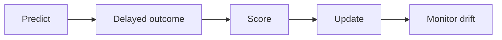
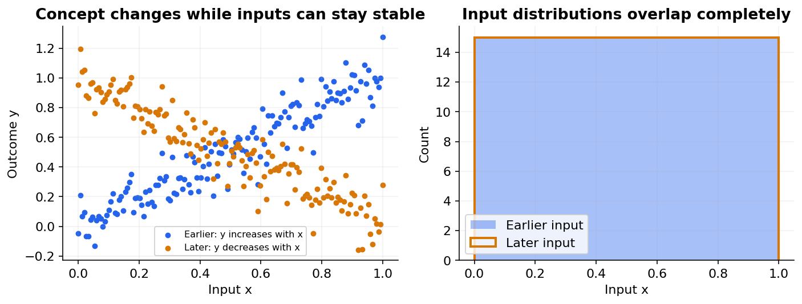

# 31 — Online learning, drift and federated learning

[Course map](README.md) · [Practicals](../02-practicals/README.md) · [Questions and answers](../03-questions-and-answers/worked-questions.md#lesson-31)

## On this page

- [Learn when data arrives over time](#learn-when-data-arrives-over-time)
- [Evaluate without learning the answer first](#evaluate-without-learning-the-answer-first)
- [Federated learning and privacy](#federated-learning-and-privacy)

## Learn when data arrives over time

Batch learning fits on a collected dataset. Online/incremental learning updates a model from new batches or examples without necessarily retraining from scratch. Stochastic gradient descent, passive-aggressive methods and incremental Naive Bayes are common choices. Streaming k-means and other summaries handle selected unsupervised tasks. Not every estimator supports a valid incremental update.

An SGD update is $w_{t+1}=w_t-\eta_t\nabla\ell_t(w_t)$ with suitable regularization. Passive-aggressive learning changes parameters just enough to correct a margin violation while penalizing a large move; its aggressiveness parameter controls the trade-off. Follow-the-regularized-leader methods accumulate past losses/gradients plus a regularizer and are useful in large sparse settings.

## Evaluate without learning the answer first

Prequential evaluation follows **predict → observe outcome → score → update**. A ticket's final resolution may arrive days later; the model must not update with a label that did not yet exist. Maintain delayed-label queues and evaluate over time windows. If you update before scoring the same row, the score is no longer a new-example estimate.

Covariate shift changes $P(X)$; label/prior shift changes $P(Y)$ under particular stable-conditional assumptions; concept drift changes $P(Y|X)$. In a general environment several can change together. Monitoring input drift alone cannot reveal every outcome relationship change. Retraining is not always the solution: an upstream measurement bug should be fixed at its source.

Tune learning-rate schedule, forgetting/window strategy, regularization, update frequency and drift response. Sliding windows adapt but forget history; weighted history can balance stability and responsiveness. Compare with a batch-retraining baseline and monitor catastrophic forgetting, adversarial updates and feedback loops.

## Federated learning and privacy

Federated learning trains across clients without centralizing raw examples. In FedAvg, clients take local steps and a server aggregates model parameters, often weighted by local sample counts. Non-IID client data, unequal resources, intermittent participation and malicious clients complicate optimization. Keeping data local is **not** a proof of privacy: model updates can leak information.

Differential privacy adds a formal neighbouring-dataset guarantee under a defined mechanism and privacy budget; gradient clipping/noise and privacy accounting change accuracy and training. Secure aggregation can hide individual client updates from the aggregator under a threat model, but does not by itself give every differential-privacy guarantee. Use the correct security/privacy expertise for deployment rather than equating these terms.

**Choose:** online learning for evolving high-volume streams with supported algorithms and clear label timing; federated learning when distributed data/governance requirements justify its complexity. Evaluate temporal performance, client-level disparities, communication cost and privacy assumptions in addition to a global metric.

---

[← 30: Semi-supervised, self-supervised, weak and active learning](30-semi-self-and-weak-supervision.md) · [32: Reinforcement learning and contextual bandits →](32-reinforcement-learning.md)
