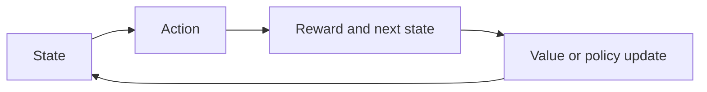
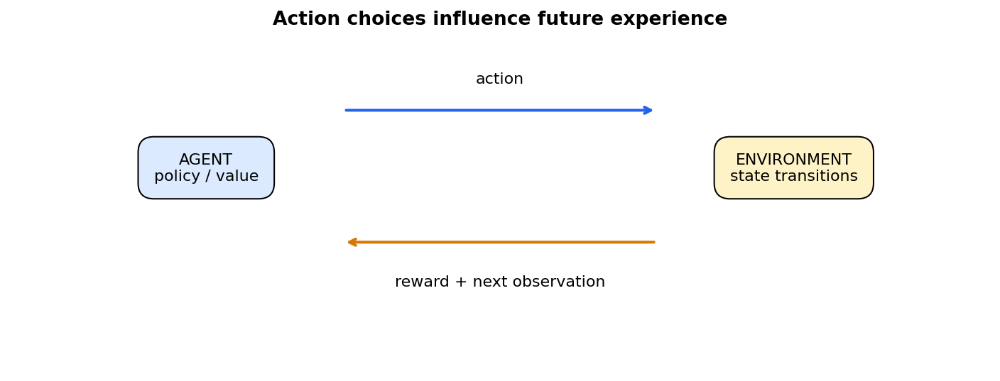

# 32 — Reinforcement learning and contextual bandits

[Course map](README.md) · [Practicals](../02-practicals/README.md) · [Questions and answers](../03-questions-and-answers/worked-questions.md#lesson-32)

## On this page

- [Learn actions whose consequences unfold](#learn-actions-whose-consequences-unfold)
- [Values and updates](#values-and-updates)

## Learn actions whose consequences unfold

A reinforcement-learning agent observes a state $s$, chooses an action $a$, receives reward $r$ and moves to another state. A policy $\pi(a|s)$ selects actions. An MDP defines states, actions, transition probabilities, rewards and discount $\gamma$. The return is $G_t=\sum_{k\ge0}\gamma^kr_{t+k+1}$. The goal is expected cumulative reward, not merely predicting a pre-existing correct action label.

A bandit has no modelled multi-step state consequences; contextual bandits use current context to select an action and observe feedback for the chosen action. Exploration gathers information; exploitation chooses what currently appears best. Historical logged actions may not cover alternatives, so naive offline comparison is biased.

## Values and updates

The Bellman optimality relation is $Q^*(s,a)=\mathbb E[r+\gamma\max_{a'}Q^*(s',a')|s,a]$. Q-learning uses a sampled update:

$$Q(s,a)\leftarrow Q(s,a)+\alpha[r+\gamma\max_{a'}Q(s',a')-Q(s,a)].$$

With $Q=2,r=1,\gamma=.9,\max Q'=4,\alpha=.1$, target 4.6 and new $Q=2.26$. For a true terminal state the bootstrap term is 0. Environment time-limit truncation is not automatically the same as a terminal state, so follow the task definition.

| Method | Main learning idea | Distinction / caution |
|---|---|---|
| Dynamic programming | Bellman updates using a known model | Needs transitions/rewards |
| Monte Carlo control | Learn from completed returns | High variance, episode dependence |
| SARSA | Bootstrap using next action actually taken | On-policy update |
| Q-learning | Bootstrap using greedy next-action value | Off-policy; tabular guarantees need conditions |
| DQN | Neural Q-function with replay and target network | Instability and extrapolation errors |
| Policy gradient / REINFORCE | Optimize expected return via log-policy gradients | High variance; baselines help |
| Actor–critic | Policy actor plus value critic | Biased/unstable critics can mislead |
| PPO | Surrogate objective constraining policy-change effects | Not a universal safety guarantee |

PPO's clipped surrogate uses a policy probability ratio $\rho_t$, advantage estimate $A_t$ and clipping range $\epsilon$: $\mathbb E[\min(\rho_tA_t,clip(\rho_t,1-\epsilon,1+\epsilon)A_t)]$. It is an optimization device, not proof that every update improves real-world reward.

Tune exploration, discount, step size, representation, reward design and horizon. Sparse rewards, reward hacking, partial observability, unsafe exploration and distribution shift are central difficulties. Evaluate multiple seeds, returns with uncertainty, constraint violations and baselines. Offline RL requires coverage and careful policy evaluation; never assume a high simulated reward authorizes real-world autonomous trials. [Sutton and Barto's textbook](https://www.andrew.cmu.edu/course/10-703/textbook/BartoSutton.pdf) is the primary reference for the core value/control framework.

---

[← 31: Online learning, drift and federated learning](31-online-and-federated-learning.md) · [33: Neural networks and representation learning →](33-neural-networks.md)
