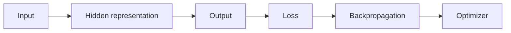
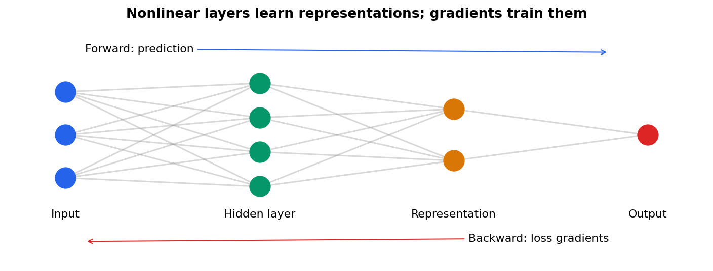

# 33 — Neural networks and representation learning

[Course map](README.md) · [Practicals](../02-practicals/README.md) · [Questions and answers](../03-questions-and-answers/worked-questions.md#lesson-33)

## On this page

- [Compose simple functions into a flexible model](#compose-simple-functions-into-a-flexible-model)
- [Train and control capacity](#train-and-control-capacity)

## Compose simple functions into a flexible model

An MLP layer computes $h=\phi(Wx+b)$. Multiple layers learn representations before an output head. ReLU uses $\max(0,z)$; sigmoid maps to(0,1); softmax normalizes exclusive class logits. Without nonlinear activations, stacked linear layers collapse into a single linear transformation.

Choose output and loss together: a linear numeric head with squared/robust loss for suitable regression, sigmoid plus binary cross-entropy for binary or multilabel outputs, softmax plus multiclass cross-entropy for exclusive labels. A neural network is not automatically supervised; autoencoders and self-supervised networks use different targets/objectives.

Backpropagation applies the chain rule to compute gradients efficiently. The optimizer uses them to update parameters. Backprop is not itself the optimizer. At $x=2,w=.1,b=0,y=1$, sigmoid output.549834 gives weight gradient $(p-y)x=-.900332$. This is the same one-neuron calculation as logistic regression; hidden layers add a chain of derivatives.

## Train and control capacity

Use minibatches, appropriate initialization, scaled inputs, a stable loss implementation and a monitored learning rate. SGD with momentum and Adam are common choices. Early stopping selects a development-validation checkpoint. Weight decay, dropout and augmentation can regularize but do not remove leakage. Batch normalization uses batch statistics during training and stored statistics during ordinary inference; training/evaluation mode matters.

| Architecture / family | Inductive bias | Typical use |
|---|---|---|
| MLP | Learned feature interactions | General vector/tabular baseline |
| CNN | Local shared filters | Images and local spatial patterns |
| RNN / LSTM / GRU | Recurrent state | Sequences and temporal context |
| Transformer | Attention-based interactions | Text, sequences and multimodal data |
| Autoencoder | Encode/decode with reconstruction objective | Compression or representation |
| Graph neural network | Aggregate graph-neighbour information | Relational data |

Architecture is not a complete algorithm specification: loss, optimizer, training data and evaluation determine what is learned. Deeper models can require more data/compute and careful hyperparameters. On modest tabular data, boosted trees or regularized linear models often provide important comparisons rather than assuming neural networks must win.

An autoencoder minimizes reconstruction error through a bottleneck, but can learn identity-like behaviour or reconstruct anomalies; its latent space is not guaranteed semantically meaningful. A variational autoencoder adds a probabilistic latent objective balancing reconstruction with a KL term; a GAN uses competing generator/discriminator objectives; diffusion models learn denoising-related objectives. These are generative-learning families, with full architecture derivations continued in the separate Deep Learning subject. Here understand their ML role, training signal and evaluation risks, not just their names.

Validate held-out performance, calibration, learning curves, robustness, latency and seed variability. A lower training loss or more parameters is not proof of better understanding or prediction.

---

[← 32: Reinforcement learning and contextual bandits](32-reinforcement-learning.md) · [34: Text, time series, survival and structured prediction →](34-specialized-prediction.md)
