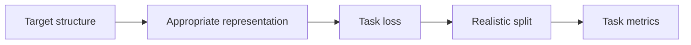
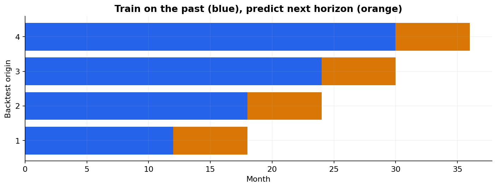

# 34 — Text, time series, survival and structured prediction

[Course map](README.md) · [Practicals](../02-practicals/README.md) · [Questions and answers](../03-questions-and-answers/worked-questions.md#lesson-34)

## On this page

- [The target structure changes the method](#the-target-structure-changes-the-method)
- [Forecasting: make time visible](#forecasting-make-time-visible)
- [Survival: respect censoring](#survival-respect-censoring)
- [Sequences and structured outputs](#sequences-and-structured-outputs)

## The target structure changes the method

Some tasks need more than a single independent number or class. Keep the general workflow, but change the representation, objective and validation to match the actual prediction.

| Task | Suitable starting methods | Objective / evaluation | Main trap |
|---|---|---|---|
| Sparse text classification | TF–IDF plus logistic regression, linear SVM or NB | Log loss/F1/PR metrics as appropriate | Near-duplicate document leakage |
| Time-series forecasting | Seasonal naive; lagged regression; ARIMA/ETS; boosted lag features | Horizon-specific MAE/RMSE/MASE, interval coverage | Future features and random splitting |
| Multilabel | Binary relevance, classifier chains, neural sigmoid heads | Per-label and example-based metrics | Assuming labels are mutually exclusive |
| Multioutput regression | Independent or joint output models | Per-output errors with meaningful units | One large-scale target dominating averages |
| Ordinal classification | Cumulative-link models, ordinal losses or justified reductions | Order-aware errors | Treating class order as arbitrary |
| Survival / time-to-event | Kaplan–Meier baseline, Cox model, survival forests | Concordance, time-dependent Brier/calibration | Treating censored time as known event time |
| Sequence labelling | HMM, CRF, contextual sequence models | Token and entity/span metrics | Evaluating only token accuracy |
| Graph prediction | Graph features, embeddings or GNNs | Task-specific ranking/classification | Using held-out graph edges during representation fitting |

## Forecasting: make time visible

For predicting sales tomorrow, features might include sales 7 and 14 days ago and an average ending today. A rolling window accidentally including tomorrow leaks the target. Backtest multiple historical forecast origins and the actual required horizon. Recursive multistep forecasts feed predictions back as inputs and can accumulate error; direct forecasts fit separate horizons. Seasonality and external variables must be available at the prediction time. Compare with seasonal naive before choosing a complex model.

## Survival: respect censoring

A customer still active after 100 days has event time $T>100$, not $T=100$. A right-censored observation records duration and an event indicator. Kaplan–Meier estimates a survival curve under appropriate censoring assumptions. Cox models $h(t|x)=h_0(t)\exp(x^T\beta)$ and uses partial likelihood based on risk sets. A coefficient $\log2$ implies a hazard ratio 2under proportional hazards; it does not mean twice the probability of an event by every time.

Survival forests model nonlinear effects without that simple proportional-hazard structure, but still need appropriate event/censoring handling. Concordance evaluates ordering of usable comparable pairs, not probability calibration at a specific horizon. Check censoring assumptions, follow-up windows and time-dependent calibration.

## Sequences and structured outputs

An HMM models hidden states and observed emissions with Markov assumptions. A CRF directly models conditional label-sequence probabilities and can encode dependencies between adjacent labels. Learning often uses likelihood-based optimization; decoding may use dynamic programming such as Viterbi. A sentence with several entity spans needs span-level evaluation, not just an impressive score dominated by “not an entity” tokens.

**Rule:** pick the split, likelihood/loss and metric for the data structure. Using an ordinary random-row benchmark for every task can make an invalid method look excellent.

---

[← 33: Neural networks and representation learning](33-neural-networks.md) · [35: Interpretability, permutation importance, SHAP and dependence plots →](35-interpretability.md)
