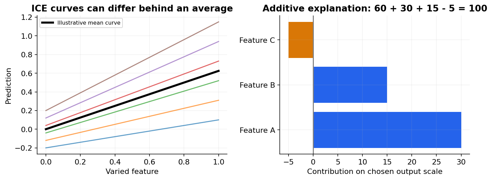

# 35 — Interpretability, permutation importance, SHAP and dependence plots

[Course map](README.md) · [Practicals](../02-practicals/README.md) · [Questions and answers](../03-questions-and-answers/worked-questions.md#lesson-35)

## On this page

- [Explain the model's behaviour, not a causal story](#explain-the-models-behaviour-not-a-causal-story)
- [How to read a plot safely](#how-to-read-a-plot-safely)

## Explain the model's behaviour, not a causal story

Interpretability asks how a model uses information. Global explanations summarize overall behaviour; local explanations describe one prediction. Both can be unstable under correlated inputs or unrealistic feature perturbations. An explanation that sounds plausible is not automatically faithful.

| Method | What is computed? | What it does not establish |
|---|---|---|
| Linear coefficient | Change in fitted score per unit, conditional on other inputs | Causality; scale-independent importance |
| Permutation importance | Held-out score drop after shuffling a feature | Unique importance when correlated features substitute |
| Partial dependence (PDP) | Average predictions while varying selected features | Validity of unrealistic correlated-feature combinations |
| ICE | Per-example prediction curves | That all curves describe feasible interventions |
| Accumulated local effects (ALE) | Aggregate local changes over observed feature regions | Automatic causal effects |
| SHAP | Shapley-style allocation relative to a background/masking definition | One universal attribution independent of background assumptions |

Permutation example: baseline held-out accuracy 0.84falls to 0.70 when featureAis shuffled, a 0.14drop under that procedure. FeatureB's drop 0.01does not prove it is irrelevant: another correlated feature may replace it. Use repeated shuffles and appropriate dependence-aware investigations. Never compute importance only on training data and assume it describes generalization.

SHAP-style additive explanations often satisfy $f(x)=\phi_0+\sum_j\phi_j$ on a defined output scale. The base value and contributions depend on the model-output scale and background. For a model output 100, baseline 60 and contributions+30,+15,−5sum to 100. These numbers allocate a prediction under a specified explanation game; they do not measure what would happen if a person changed one input in the real world.

## How to read a plot safely

PDP can average over impossible combinations such as a ten-year-old with 30 years employed. ICE reveals variation across examples; ALE reduces some extrapolation by using local observed regions but still requires interpretation. With interacting features, one-feature summaries may hide key behaviour. Show distributions and uncertainty/stability when possible.

Choose a small understandable model when it meets the task; a complex model plus an explanation layer is not inherently more transparent. For high-stakes use, also inspect data provenance, feature availability, subgroup errors and decision process. A model may faithfully explain its use of a proxy for sensitive information, which does not make that use acceptable.

**Workflow:** choose the question, use an explanation appropriate to it, inspect realistic examples, test explanation stability and compare with domain constraints. If an explanation contradicts a controlled perturbation of the model, investigate the explainer or its assumptions. Explain predictions separately from recommendations about interventions.

---

[← 34: Text, time series, survival and structured prediction](34-specialized-prediction.md) · [36: Uncertainty, prediction intervals and conformal prediction →](36-uncertainty-and-conformal.md)
