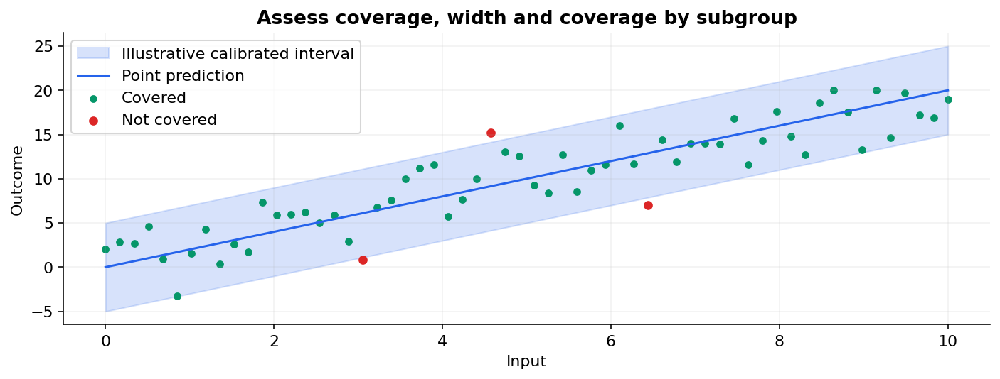

# 36 — Uncertainty, prediction intervals and conformal prediction

[Course map](README.md) · [Practicals](../02-practicals/README.md) · [Questions and answers](../03-questions-and-answers/worked-questions.md#lesson-36)

## On this page

- [A prediction needs an honest sense of error](#a-prediction-needs-an-honest-sense-of-error)
- [Split conformal regression, step by step](#split-conformal-regression-step-by-step)
- [More informative intervals and sets](#more-informative-intervals-and-sets)

## A prediction needs an honest sense of error

Aleatoric uncertainty describes outcome variability conditional on available inputs; epistemic uncertainty describes uncertainty about a learned model/parameters. The separation depends on the modelling framework. A single point estimate hides both. Confidence intervals for a mean/parameter are not prediction intervals for a new individual outcome, which also includes outcome variability.

Bootstrap ensembles can estimate aspects of variability by refitting resampled data, with assumptions about sampling and dependence. Quantile regression directly targets conditional quantiles. Bayesian predictive intervals integrate model uncertainty under priors and likelihood. None is automatically calibrated under distribution shift.

## Split conformal regression, step by step

1. Split training, calibration and final evaluation data. Fit a predictor on training only.
2. Compute calibration scores $s_i=|y_i-\hat f(x_i)|$ for $m$ calibration cases.
3. Let $k=\lceil(m+1)(1-\alpha)\rceil$. Use the $k$ th smallest score as $q$ with the standard infinite-endpoint convention if $k>m$.
4. Return interval $[\hat f(x)-q,\hat f(x)+q]$.

For $m=9,\alpha=.2$ and sorted scores $[1,1,2,2,3,3,4,5,8]$, $k=\lceil10\times.8\rceil=8$, so $q=5$. A point prediction 30 gets interval[25,35]. Under exchangeability of calibration and future examples and the appropriate protocol, split conformal provides marginal coverage at least the nominal level. It does not guarantee 80%coverage for every input subgroup or every individual value of $x$.

The quantile is not simply a software's default 80th percentile interpolation; the finite-sample rank correction matters. Choosing features, models or thresholds repeatedly using the same calibration scores can compromise the intended guarantee. Keep tuning separate, or use a conformal procedure designed for that reuse.

## More informative intervals and sets

Constant residual intervals have equal width everywhere. Conformalized quantile regression starts with lower/upper quantile models and calibrates their nonconformity scores to adapt widths. Classification conformal methods produce sets of labels; empty or large sets have operational meaning and should be inspected. Regression intervals need coverage **and** average width, plus subgroup/time checks.

In forecasting, exchangeability often fails because observations depend on time. Use a method justified for that setting and evaluate coverage over realistic backtests; do not paste an IID guarantee onto dependent data. A very wide interval can achieve coverage while being useless, and a very narrow one can look precise while missing systematically. Decide what uncertainty information supports the action, including abstention or human review.

---

[← 35: Interpretability, permutation importance, SHAP and dependence plots](35-interpretability.md) · [37: Causality, fairness, robustness and responsible evaluation →](37-causality-fairness-and-robustness.md)
