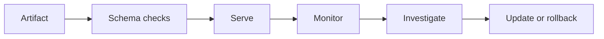
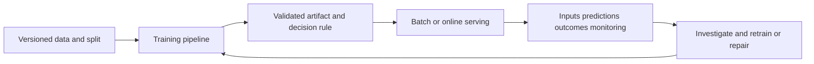

# 38 — Deployment, reproducibility and monitoring

[Course map](README.md) · [Practicals](../02-practicals/README.md) · [Questions and answers](../03-questions-and-answers/worked-questions.md#lesson-38)

## On this page

- [The model file is only part of the system](#the-model-file-is-only-part-of-the-system)
- [Evaluate the complete decision path](#evaluate-the-complete-decision-path)
- [Maintain and retire deliberately](#maintain-and-retire-deliberately)

## The model file is only part of the system

Deploy the entire preprocessing and prediction pipeline with its schema, class order, threshold, feature definitions and versions. A model trained on dollars cannot safely serve inputs in cents. Training–serving skew arises when offline and online features are computed differently or use different availability windows.

A reproducible experiment records dataset/version identifiers, code commit, environment, seeds, parameters, split logic and metrics. Seeds reduce some randomness but do not guarantee bitwise-identical distributed/GPU results. A model registry links approved artifacts to this evidence. Do not deserialize arbitrary untrusted model files: some serialization formats can execute code.

## Evaluate the complete decision path

Unit tests can verify schema and transformations. Integration tests can compare representative offline and served predictions. A shadow deployment generates predictions without acting; a canary gradually exposes real traffic under monitoring. An A/B experiment compares defined outcomes with correct randomization, duration and stopping rules. Offline improvement does not guarantee incremental user benefit.

| Monitor | Example signal | Response investigation |
|---|---|---|
| Input quality | Missing-value spike, new category, unit shift | Upstream data/process change |
| Prediction distribution | Scores suddenly all near 0 | Pipeline, model or population shift |
| Outcome performance | Delayed recall/calibration deterioration | Label timing, drift, changed intervention |
| Serving | Latency, error rate, resource use | Infrastructure or artifact issue |
| Decision effects | Review queue overload, group disparity | Threshold/capacity/policy mismatch |

Outcome labels often arrive late or selectively. A blocked transaction may never reveal the outcome it would have had; interventions change the data observed. Monitor label availability and selection, not just a metric computed on the easiest-to-observe cases. Input drift does not always imply performance loss, and stable inputs do not guarantee stable relationships.

## Maintain and retire deliberately

Set retraining triggers using evidence, not just a calendar. If a feature broke, fix its computation; retraining on corrupted data can institutionalize the bug. Maintain a baseline/fallback, rollback procedure and ownership. Compare proposed replacements with the current model on comparable temporal data and practical constraints. Retire models whose task, policy or data collection no longer makes sense.

**Example:** a fraud model's daily score histogram shifts after a new payment provider arrives. Check schema, currency and missing fields before deciding this is behavioural drift. Then examine delayed outcomes and provider-specific errors. This sequence prevents a reflex retraining job from concealing a data integration problem.

---

[← 37: Causality, fairness, robustness and responsible evaluation](37-causality-fairness-and-robustness.md) · [39: Choose an algorithm and diagnose the result →](39-algorithm-selection.md)
