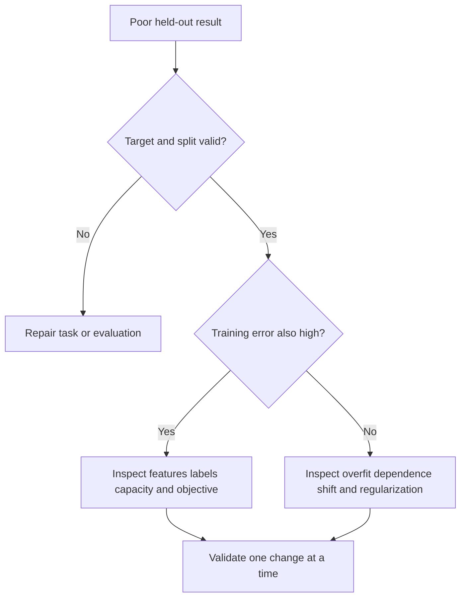

# 39 — Choose an algorithm and diagnose the result

[Course map](README.md) · [Practicals](../02-practicals/README.md) · [Questions and answers](../03-questions-and-answers/worked-questions.md#lesson-39)

## On this page

- [Use assumptions and constraints, then compare fairly](#use-assumptions-and-constraints-then-compare-fairly)
- [A practical diagnostic sequence](#a-practical-diagnostic-sequence)
- [Compare the true cost](#compare-the-true-cost)

## Use assumptions and constraints, then compare fairly

No algorithm is best for every dataset. Start with an informative cheap baseline, then choose a small set with distinct inductive biases. Use the same valid folds, preprocessing boundaries and decision metric. Record tuning budgets so a heavily tuned model is not compared misleadingly with an untouched default.

| Data / requirement | Start with | Compare with | Important caveat |
|---|---|---|---|
| Moderate dense tabular data | Regularized linear model, forest | Gradient boosting | Interactions, category handling and leakage dominate |
| Sparse high-dimensional text | Logistic regression, linear SVM, NB | Learned embeddings | Kernel matrices may be impractical |
| Small smooth numeric dataset, uncertainty | GP or regularized regression | Kernel methods | Kernel assumptions and uncertainty calibration |
| Interpretability with adequate fit | Linear model or restrained tree | Additive model / constrained boosting | Coefficients/explanations remain noncausal |
| Irregular unlabeled groups | DBSCAN/HDBSCAN or spectral method | GMM, hierarchy | Similarity and density scales define success |
| Fast evolving stream | Incremental linear/NB baseline | Supported online methods | Label delay and evaluation order |
| Images / rich sequences | Suitable pretrained representation | Task-specific neural model | Data, compute, leakage and domain mismatch |
| Cold-start recommendation | Popularity/content fallback | Hybrid recommender | Exposure bias and item availability |

## A practical diagnostic sequence

First verify the target and split. Second fit a trivial baseline. Third inspect a few predictions and transformed records. Then compare training and validation performance, slice errors and inspect learning curves. Only after this should hyperparameter search become large. A better target, a corrected join or a missing business variable can matter more than changing estimator families.

**Scenario 1:** a tree has zero training error and weak validation. Check duplicates/groups, then depth/min-leaf regularization and forests. **Scenario 2:** a linear model fails on both sets but residuals show a smooth curve. Try nonlinear features/splines or trees. **Scenario 3:** high AUC but poor fraud precision. Examine prevalence, threshold and review capacity before retraining. **Scenario 4:** strong random-split forecast but bad next-month results. Rebuild chronological evaluation before selecting a different architecture.

## Compare the true cost

Training time, prediction latency, memory, explainability, missing-data behaviour and maintenance count alongside predictive metrics. Kernel SVM/GP methods can become expensive with many rows; KNN shifts cost to prediction; trees provide threshold interactions; neural nets can exploit structured input with enough appropriate data or pretraining. These are tendencies, not benchmark guarantees.

Report baseline and candidate scores with sample sizes, uncertainty where justified, error slices and known limits. Do not overinterpret tiny improvements across noisy splits. Finish by articulating **why this method suits this data and decision**, not merely “it had the highest score”.

---

[← 38: Deployment, reproducibility and monitoring](38-deployment-and-monitoring.md) · [40: Advanced families, formula sheet and coverage map →](40-advanced-catalog-and-formula-sheet.md)
