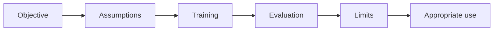

# 40 — Advanced families, formula sheet and coverage map

[Course map](README.md) · [Practicals](../02-practicals/README.md) · [Questions and answers](../03-questions-and-answers/worked-questions.md#lesson-40)

## On this page

- [Extend the course without losing the sequence](#extend-the-course-without-losing-the-sequence)
- [Formula sheet](#formula-sheet)
- [What is covered where?](#what-is-covered-where)
- [Primary reference library](#primary-reference-library)

## Extend the course without losing the sequence

The preceding chapters give worked foundations and detailed treatment of the common classical families. This catalogue makes additional families visible and states their learning principle and when they deserve deeper study. It is a reference map, not a claim that every named research variant has a full derivation here. Use a method's assumptions, objective and evaluation requirements to connect it to the course rather than memorizing names.

| Additional family | Learning principle / objective | Use and limitation |
|---|---|---|
| Generalized additive models (GAMs) | Sum learned feature functions, often penalized spline losses | Interpretable nonlinear effects; interactions require explicit handling |
| Explainable boosting machines | Boosted additive shape functions with selected interactions | Tabular explanation; still needs validation and interaction limits |
| Kernel ridge | Squared error plus RKHS norm penalty | Nonlinear smooth prediction; kernel matrix cost |
| Relevance vector machines | Sparse Bayesian kernel model | Probabilistic sparse prediction; nonconvex inference |
| Nearest centroid / shrunken centroid | Per-class representative distances, optionally shrunk | Cheap baseline; misses complex within-class structure |
| Perceptron / passive-aggressive | Mistake/margin-based online updates | Sparse online tasks; probabilities not intrinsic |
| Oblique trees / rule lists | Multifeature splits or logical rules under fit/complexity criteria | Compact rules; search complexity and stability |
| Rotation / random-patch ensembles | Vary representations or sampled features/rows | Diversity; extra computation and tuning |
| Fuzzy c-means | Membership-weighted distances with fuzziness exponent | Soft centre clusters; metric and initialization sensitivity |
| Affinity propagation | Message passing to choose exemplars from similarities | Exemplar discovery; similarity storage and preference sensitivity |
| Spectral biclustering / co-clustering | Joint row/column structure from matrix spectra | Gene/text interaction blocks; matrix assumptions |
| Self-organizing maps | Neighbourhood-preserving prototype updates | Topological visualization; map/learning settings matter |
| Probabilistic graphical models | Factorized joint/conditional distributions; likelihood or approximate inference | Dependencies and structured reasoning; inference can be costly |
| Hidden Markov / state-space models | Latent temporal transitions plus emissions | Sequences; Markov/distribution assumptions |
| Bayesian networks | Directed factorization, structure/parameter learning | Dependency modelling; graph alone does not prove causality |
| Gaussian graphical models | Sparse precision/covariance estimation | Conditional associations; distribution/regularization assumptions |
| Robust PCA / matrix completion | Low-rank plus sparse decomposition / observed-entry loss | Corruption or missing matrix entries; identifiability and sampling assumptions |
| Metric learning | Pair/triplet or neighbourhood losses on learned distance | Retrieval/KNN improvements; pair quality and leakage |
| Extreme learning / reservoir computing | Fit output layers over fixed/random dynamical features | Fast specialized alternatives; representation limitations |
| Multi-task / transfer learning | Shared representation/regularizer across related tasks | Borrow statistical strength; negative transfer |
| Multiple-instance learning | Bag-level labels with latent instance relevance | Weakly labelled sets; assumptions about positive bags |
| Positive–unlabelled learning | Risk estimation with incomplete positive labels | Missing negative labels; class-prior/selection assumptions |
| Distributionally robust optimization | Optimize worst-case loss in a specified distribution set | Shift robustness; uncertainty set may miss reality |
| Learning-to-defer / selective prediction | Predict or abstain under accuracy/coverage cost | Human review; calibrate abstention and reviewer capacity |
| Neuro-symbolic / constraint learning | Combine learned functions with logical/structural constraints | Domain consistency; constraints and optimization can conflict |
| Evolutionary / genetic programming | Search candidate structures with fitness and variation | Model/feature search; high cost and selection overfitting |

## Formula sheet

| Concept | Core expression | Interpretation |
|---|---|---|
| Empirical objective | $n^{-1}\sum\ell_i+\lambda\Omega$ | Fit plus regularization |
| Gradient step | $\theta-\eta\nabla J$ | Move against increasing loss |
| Linear prediction | $b+x^Tw$ | Additive feature score |
| Sigmoid | $1/(1+e^{-z})$ | Binary probability link |
| Binary log loss | $-y\log p-(1-y)\log(1-p)$ | Penalize wrong probabilities |
| Bayes score | $\log P(c)+\log P(x\mid c)$ | Prior plus class likelihood |
| Gini | $1-\sum p_k^2$ | Class mixture impurity |
| SVM hinge | $\max(0,1-yf)$ | Penalize insufficient signed margin |
| K-means | $\sum\|x_i-\mu_{c_i}\|^2$ | Compact centre-based groups |
| GMM | $\sum_k\pi_k\mathcal N(x;\mu_k,\Sigma_k)$ | Mixture density |
| PCA covariance | $X_c^TX_c/(n-1)$ | Directions of centred variation |
| Bellman target | $r+\gamma\max Q'$ | Immediate plus discounted future value |

## What is covered where?

- **Core supervised algorithms:** Chapters 08–18, including fitting objectives, examples, hyperparameters and comparisons.
- **Unsupervised structure and anomalies:** Chapters 19–25, including density, projections and diagnostics.
- **Other learning settings and tasks:** Chapters 27–34, from probabilistic prediction and recommendation through RL and structured targets.
- **Reliable use:** Chapters 01–07, 26 and 35–39cover data, metrics, selection, uncertainty, interpretation, fairness and deployment.
- **Practice and recall:** the practicals include original assignments plus runnable synthetic labs; the question bank follows the same numbered lessons.

Deep network architectures, full statistical proofs, causal identification and specialized survival/RL research each extend into substantial subjects. The linked primary references support further derivations; this course gives the coherent ML foundation and flags where methods have only a survey treatment. New research algorithms should be added to the matching chapter and catalogue rather than creating an unnumbered parallel syllabus.

## Primary reference library

The course explanations and examples are original teaching material. Consult these official sources for estimator details, assumptions and current API behaviour:

- [scikit-learn User Guide](https://scikit-learn.org/stable/user_guide.html): supervised/unsupervised methods, transformations, inspection and model selection.
- [XGBoost model derivation](https://xgboost.readthedocs.io/en/stable/tutorials/model.html): regularized tree objective and second-order leaf/split derivations.
- [LightGBM features](https://lightgbm.readthedocs.io/en/stable/Features.html) and [CatBoost concepts](https://catboost.ai/docs/en/concepts/): implementation-specific boosting designs.
- [Sutton and Barto, Reinforcement Learning](https://www.andrew.cmu.edu/course/10-703/textbook/BartoSutton.pdf): values, policies, temporal-difference learning and control.
- [Rasmussen and Williams, Gaussian Processes for Machine Learning](https://gaussianprocess.org/gpml/): probabilistic kernel prediction and inference.
- [Angelopoulos and Bates, conformal prediction introduction](https://arxiv.org/abs/2107.07511): finite-sample prediction sets and assumptions.
- [van der Maaten and Hinton, t-SNE](https://jmlr.org/papers/v9/vandermaaten08a.html): local-neighbourhood visualization objective.
- [Lundberg and Lee, SHAP](https://arxiv.org/abs/1705.07874): additive feature-attribution framework.

**Completion test:** choose a real task, build a leakage-safe baseline and competitor, justify loss/metric/split, inspect failures and uncertainty, then explain the deployment decision. Naming every algorithm is less useful than being able to perform that chain correctly.

---

[← 39: Choose an algorithm and diagnose the result](39-algorithm-selection.md)
