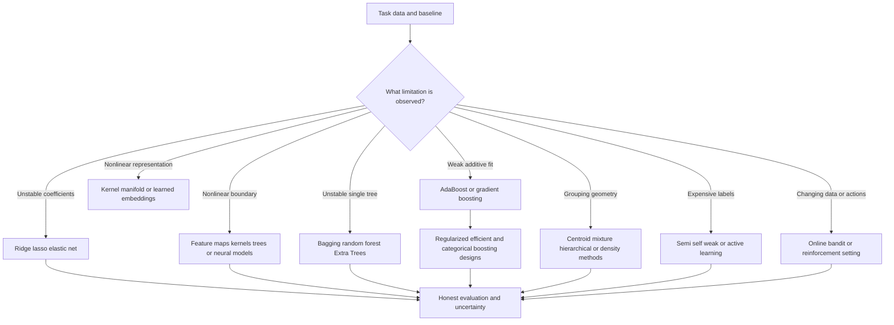

# The branching story of machine-learning algorithms

[Subject home](../README.md) · [Foundation course](README.md) · [Practicals](../02-practicals/README.md)

Read this as a map of motivations, not a claim that researchers invented every next model because the previous one failed. Follow the linked worked lessons for equations, training objectives, calculations and tuning.

## Read the motivation, mechanism and trade-off together

| Family / transition | Limitation or question | How the method works | What remains / why another branch matters | Read |
|---|---|---|---|---|
| Linear regression → ridge / lasso / elastic net | Collinearity/high flexibility can destabilize least-squares coefficients. | Add L2, L1 or mixed penalties under a stated loss convention. | Shrinkage adds bias and requires scale/penalty tuning; it does not robustly remove every outlier. | [Lesson](09-regularized-and-generalized-regression.md) |
| Linear features → splines / kernels / neural features | A straight additive relationship misses curvature/interactions. | Change the representation or similarity and fit an appropriate objective. | More flexibility can overfit and worsen extrapolation; validate the full transformation. | [Lesson](08-linear-regression.md) |
| Generative NB/LDA/QDA versus discriminative logistic | Different assumptions offer different data/interpretation trade-offs. | Model class likelihoods/priors or directly optimize conditional probabilities. | These are parallel modelling choices, not a universal chronology in which logistic replaces Bayes. | [Lesson](11-bayes-and-discriminant-analysis.md) |
| Linear boundary → kernels / SVM | A margin model can gain nonlinear similarity without explicit feature enumeration. | Optimize hinge/norm trade-off using a suitable kernel. | Kernel compute, scaling and calibration remain; scores are not automatic probabilities. | [Lesson](13-support-vector-machines.md) |
| Single tree → bagging / random forest / Extra Trees | A deep greedy tree can vary greatly with the sample. | Average resampled/randomized trees to reduce selected variance/correlation. | Shared bias persists and interpretability/serving cost can worsen. | [Lesson](15-bagging-and-forests.md) |
| Weak learners → AdaBoost / gradient boosting | A single simple rule can leave systematic error. | Reweight mistakes under a formulation or fit loss-gradient corrections sequentially. | Noise, tuning and sequential cost remain; boosting is not the same mechanism as bagging. | [Lesson](17-gradient-boosting.md) |
| Gradient boosting → XGBoost / LightGBM / CatBoost designs | Regularization, throughput and categorical handling need practical improvements. | Use selected second-order, histogram, growth or ordered/categorical strategies. | Implementation choices differ; no library name guarantees best quality or leakage safety. | [Lesson](17-gradient-boosting.md) |
| Separate estimators → voting / stacking | Different validated errors can be complementary. | Average compatible outputs or learn a combiner from honest out-of-fold predictions. | In-sample stacking leaks fit quality; extra serving cost may outweigh a tiny gain. | [Lesson](18-voting-and-stacking.md) |
| K-means → GMM / hierarchy / density branches | Spherical hard-assignment groups do not fit every structure. | Use soft likelihood components, linkage structure or density connectivity under a defined metric. | Each changes the objective; cluster quality is not interchangeable across algorithms. | [Lesson](22-mixtures-and-em.md) |
| Linear PCA → kernel / manifold / learned representation | Some important geometry is nonlinear. | Optimize a kernel/graph/neighbourhood/reconstruction objective. | Attractive 2D maps do not prove true classes or useful predictive features. | [Lesson](24-manifolds-and-spectral-methods.md) |
| Outlier screening → novelty / supervised fraud | Unusual geometry is not the same as a harmful labelled event. | Fit isolation/density/boundary rules or a target-specific classifier. | Scores and business labels differ; thresholds need capacity/error-cost evidence. | [Lesson](25-anomaly-detection.md) |
| Point prediction → probability / Bayesian / conformal uncertainty | One estimate does not express expected error or coverage. | Model distributions or calibrate prediction sets under an explicit protocol. | Coverage is conditional on assumptions; marginal coverage is not universal subgroup assurance. | [Lesson](36-uncertainty-and-conformal.md) |
| Labelled-only learning → semi/self/active/weak learning | Task labels may be expensive or incomplete. | Use unlabelled structure, generated targets, label-selection or noisy-source models. | Pseudo-label errors, bias and held-out evaluation still matter. | [Lesson](30-semi-self-and-weak-supervision.md) |
| Batch supervised tasks → online / bandit / RL | Data/decisions may evolve or affect future experience. | Update incrementally or learn action values/policies from interaction. | Feedback, exploration and delayed labels change the evaluation problem. | [Lesson](32-reinforcement-learning.md) |

## How to compare alternatives

Use the same task, eligible data, split/horizon and compute budget. State the objective, assumptions, training/update procedure, important settings and failure cases. A newer publication can address one bottleneck while being worse on another. A survey row identifies a family; it does not pretend to derive every research variant.

For a method you study, complete this sentence: “I would consider it because ___; it works by ___; I would compare it with ___ using ___; I would avoid or investigate it when ___.” Recalculate the worked examples before selecting by a method name.

[Broader advanced ML family catalogue and formula sheet](40-advanced-catalog-and-formula-sheet.md).
