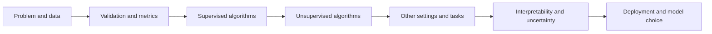

# Machine Learning — theory in learning order

[Subject home](../README.md) · [Practicals](../02-practicals/README.md) · [Question bank](../03-questions-and-answers/worked-questions.md)

Start at 01 and follow the numbered chapters. Each lesson explains the idea, objective/training procedure, worked example, suitable data and practical limits. Read the diagrams as part of the explanation, then try the corresponding practical and questions. Formula conventions are stated where they differ across libraries.

## A. Foundations: learn to evaluate before choosing a model

1. [What machine learning learns](01-learning-map.md)
2. [Data preparation, feature engineering and leakage](02-data-and-features.md)
3. [Generalization, bias, variance and learning curves](03-generalization.md)
4. [Splits, cross-validation and hyperparameter search](04-validation.md)
5. [Loss functions and optimization](05-loss-and-optimization.md)
6. [Regression metrics and residual diagnostics](06-regression-metrics.md)
7. [Classification metrics, thresholds and calibration](07-classification-metrics.md)

## B. Supervised algorithms: detailed worked lessons

8. [Linear regression: the full reasoning](08-linear-regression.md)
9. [Ridge, lasso, elastic net and generalized regression](09-regularized-and-generalized-regression.md)
10. [Logistic regression and softmax classification](10-logistic-and-softmax.md)
11. [Naive Bayes, LDA and QDA](11-bayes-and-discriminant-analysis.md)
12. [K-nearest neighbours and distance](12-nearest-neighbours.md)
13. [SVM, kernels and support vector regression](13-support-vector-machines.md)
14. [Decision trees: entropy, Gini, regression and pruning](14-decision-trees.md)
15. [Bagging, random forests and Extra Trees](15-bagging-and-forests.md)
16. [AdaBoost: learning from weighted mistakes](16-adaboost.md)
17. [Gradient boosting, XGBoost, LightGBM and CatBoost](17-gradient-boosting.md)
18. [Voting, stacking and blending](18-voting-and-stacking.md)

## C. Unsupervised structure and unusual observations

19. [K-means, k-means++, mini-batch and k-medoids](19-centroid-clustering.md)
20. [Hierarchical clustering and BIRCH](20-hierarchical-clustering.md)
21. [DBSCAN, OPTICS and HDBSCAN](21-density-clustering.md)
22. [Gaussian mixtures, EM and density estimation](22-mixtures-and-em.md)
23. [PCA, SVD, NMF, ICA and cross-decomposition](23-linear-dimension-reduction.md)
24. [Kernel PCA, manifolds, t-SNE, UMAP and spectral methods](24-manifolds-and-spectral-methods.md)
25. [Anomaly, novelty and outlier detection](25-anomaly-detection.md)

## D. Additional learning settings and targets

26. [Feature selection, imbalanced learning and label quality](26-feature-selection-and-imbalance.md)
27. [Bayesian learning and Gaussian processes](27-bayesian-learning-and-gaussian-processes.md)
28. [Recommendation, matrix factorization and ranking](28-recommendation-and-ranking.md)
29. [Association rules, Apriori and FP-growth](29-association-rules.md)
30. [Semi-supervised, self-supervised, weak and active learning](30-semi-self-and-weak-supervision.md)
31. [Online learning, drift and federated learning](31-online-and-federated-learning.md)
32. [Reinforcement learning and contextual bandits](32-reinforcement-learning.md)
33. [Neural networks and representation learning](33-neural-networks.md)
34. [Text, time series, survival and structured prediction](34-specialized-prediction.md)

## E. Explain, quantify uncertainty and use models responsibly

35. [Interpretability, permutation importance, SHAP and dependence plots](35-interpretability.md)
36. [Uncertainty, prediction intervals and conformal prediction](36-uncertainty-and-conformal.md)
37. [Causality, fairness, robustness and responsible evaluation](37-causality-fairness-and-robustness.md)
38. [Deployment, reproducibility and monitoring](38-deployment-and-monitoring.md)
39. [Choose an algorithm and diagnose the result](39-algorithm-selection.md)
40. [Advanced families, formula sheet and coverage map](40-advanced-catalog-and-formula-sheet.md)

## How to study

For every algorithm, answer: what task, what representation, what objective, what solver, what assumptions, what hyperparameters, what failure modes, and what valid comparison? Recalculate its worked example before running the code. Revisit the question bank without looking at the answers first.

The common classical algorithms receive worked lessons. Specialist and research families are identified in the final catalogue with their principles and limits; a catalogue entry is not presented as a complete specialist textbook. Neural architectures and other specialist areas continue in their own hub subjects.

[Reproduce the plotted figures](assets/generate_visuals.py) with the [lab dependencies](../02-practicals/labs/requirements.txt). Plots use synthetic examples; the text identifies illustrative rather than measured curves.

[ROC/PR/calibration and optimization figure source](assets/generate_metric_figures.py).
