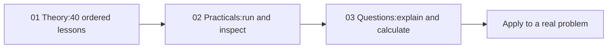

# 04 — Machine Learning

[Learning Hub](../README.md)

**[Start the algorithm story](01-theory/ALGORITHM-STORY.md)** — understand the problem, mechanism, limitation and related alternatives.

A course from the first modelling decision to reliable real-world use. Begin with supervised versus unsupervised learning, then learn the algorithms with equations, calculations, plots and decision diagrams. The material expands the original notes with additional explanations and corrected worked examples.

| Read in this order | What you will find |
|---|---|
| [01 — Theory and full course map](01-theory/README.md) | Foundations; supervised/unsupervised algorithms; advanced settings; uncertainty; explainability; model selection |
| [02 — Practicals](02-practicals/README.md) | Runnable labs, original notebooks, datasets and course assignments |
| [03 — Questions and answers](03-questions-and-answers/README.md) |200 answered questions following the same 40 lessons |
| [Archive — original notes](archive/README.md) | Original handwritten PDFs retained for reference |

**Start here:** [01 — What machine learning learns](01-theory/01-learning-map.md).

The main theory course includes worked classical methods and a clearly marked advanced-family reference. Use its final coverage map to distinguish detailed lessons from specialist surveys. The original PDFs remain intact; you can study the Markdown course without following migration records or leaving this repository.

[← SQL and Data Analysis](../03-sql-and-data-analysis/README.md) · [Deep Learning →](../05-deep-learning-and-nlp/README.md)
