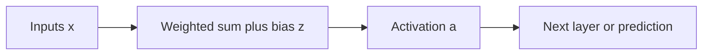
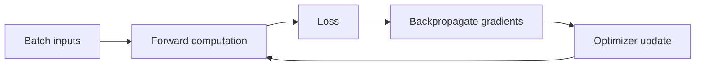
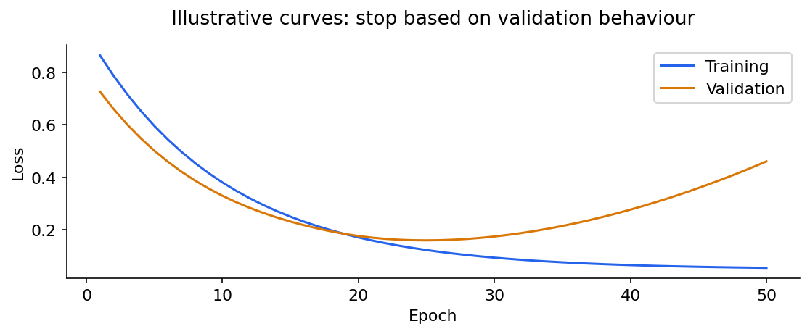

# Deep learning 1: neurons, activations and backpropagation

[Subject home](../README.md) · [Theory index](README.md)

A neural network composes simple numerical transformations into a flexible function. It is loosely inspired by biological neurons, but its operations are mathematical; a model does not need to imitate a brain to be useful. It learns representations from data, and still needs suitable labels, objectives and validation.

## On this page

- [1. A neuron is a weighted sum followed by a function](#1-a-neuron-is-a-weighted-sum-followed-by-a-function)
- [2. Choose an activation for its role](#2-choose-an-activation-for-its-role)
- [3. Match output, target and loss](#3-match-output-target-and-loss)
- [4. Forward pass, chain rule and updates](#4-forward-pass-chain-rule-and-updates)
- [5. Vanishing and exploding gradients](#5-vanishing-and-exploding-gradients)
- [6. Initialization, batches and optimizers](#6-initialization-batches-and-optimizers)
- [7. Regularize and diagnose](#7-regularize-and-diagnose)

## 1. A neuron is a weighted sum followed by a function

$$z=w^Tx+b,\qquad a=f(z).$$

For $x=(2,1)$, $w=(0.5,-1)$ and $b=0.2$, the score is $2(0.5)+1(-1)+0.2=0.2$. A sigmoid output is about 0.5498. A step function converts a score directly to a hard decision; its derivative is unsuitable for ordinary gradient training. The classical perceptron uses a different update rule and learns a linear separator when the conditions allow it.

Bias shifts the activation boundary. Weights control input influence, including sign. A dense layer computes this for several neurons at once: $Z=XW+b$. A stack of affine layers without nonlinear activations is still just an affine transformation, regardless of its depth.

## 2. Choose an activation for its role

| Activation | Formula | Useful interpretation and limitation |
|---|---|---|
| Sigmoid | $1/(1+e^{-z})$ | Output in (0,1); derivative at most 0.25; saturates |
| Tanh | $\tanh z$ | Zero-centred output in (-1,1); also saturates |
| ReLU | $\max(0,z)$ | Simple hidden-layer nonlinearity; inactive side has zero derivative |
| Leaky ReLU | $\max(az,z)$, small positive a | Small negative-side slope |
| PReLU | Leaky form with learned a | Learns the negative slope |
| ELU | z if positive, $a(e^z-1)$ otherwise | Smooth negative part; behaviour depends on a |
| Swish/SiLU | $z\sigma(z)$ | Smooth gated nonlinearity |
| Softmax | $e^{z_j}/\sum_ke^{z_k}$ | A distribution over mutually exclusive classes |

ReLU can help gradient flow but does not guarantee vanishing gradients are impossible. A “dead” ReLU may repeatedly receive negative input and zero gradient. Leaky variants mitigate that mechanism without guaranteeing perfect training. ELU outputs are not guaranteed to have mean zero on arbitrary data.

For stable softmax, subtract the maximum logit first. Logits $(1,2,3)$ give probabilities approximately $(0.0900,0.2447,0.6652)$. Multiclass softmax is different from taking an argmax: argmax produces a class index, not the training loss or the full distribution.

## 3. Match output, target and loss

| Task | Target | Output idea | Training loss |
|---|---|---|---|
| Numeric prediction | Real value | Linear output | MSE, MAE or Huber |
| Binary classification | 0/1 | One logit/sigmoid | Binary cross-entropy |
| One of several classes | Class index or one-hot | Class logits/softmax | Multiclass cross-entropy |
| Several labels can apply | Multi-hot flags | One logit per label | Per-label binary cross-entropy |

Sparse categorical cross-entropy uses integer class labels; categorical cross-entropy uses the equivalent one-hot labels. It does **not** discard all probabilities except the argmax. Framework losses may take logits and apply the needed transformation internally; avoid applying it twice.

The regression and log-loss derivations live in the machine-learning guide. In a nonlinear network, even a squared-error loss does not make the objective convex in all network weights.

## 4. Forward pass, chain rule and updates

A forward pass computes predictions. A loss compares them with targets. Backpropagation computes derivatives through the computation graph. The optimizer uses those derivatives to update parameters. Backpropagation and the optimizer are different steps.

### A complete small derivative

Use one sigmoid neuron, $x=2$, $w=0.1$, $b=0$, target $y=1$. Then $z=0.2$, $p=0.549834$. Binary cross-entropy is $-\log p\approx0.598139$. With sigmoid plus this loss, $\partial L/\partial z=p-y=-0.450166$.

$$\frac{\partial L}{\partial w}=(p-y)x=-0.900332,\qquad \frac{\partial L}{\partial b}=p-y=-0.450166.$$

At learning rate 0.1, update to $w=0.1900332$, $b=0.0450166$. The new score is 0.425083 and the probability rises to about 0.6047; the loss falls to about 0.5030. The arithmetic shows why subtracting a negative gradient increases the parameter.

For a deeper path, multiply local derivatives using the chain rule. If a weight influences the loss through two branches, **add** the contributions from both paths. Automatic differentiation performs this bookkeeping; it does not choose a good loss or fix incorrect data.

## 5. Vanishing and exploding gradients

A long chain multiplies many derivatives and weights. Repeated small factors can make early-layer gradients tiny; large factors can make them explode. For example, $0.25^{10}\approx9.54\times10^{-7}$ illustrates shrinking factors, though actual networks also include weight matrices and multiple paths.

Use suitable initialization, activations, normalization or residual/gated paths for the architecture, and inspect gradient behaviour. Gradient clipping limits gradient norm and helps with explosions; it does not solve every training issue. Lowering learning rate can control update size without fixing vanishing gradients itself.

## 6. Initialization, batches and optimizers

Hidden units need symmetry-breaking initialization; all identical weights can make them learn identical features. Xavier normal uses variance $2/(fan_{in}+fan_{out})$; Xavier uniform uses bounds $\pm\sqrt{6/(fan_{in}+fan_{out})}$. He normal commonly uses variance $2/fan_{in}$ for ReLU-style layers. These are scale choices for a model, not a promise that all weights should simply be “very small”.

An epoch is one pass through the training set. An iteration/update processes one batch. With 1,000 rows and batch size 100, there are 10 updates per epoch, not 10 epochs. Full-batch uses all rows for an update; SGD traditionally uses one; mini-batch uses a subset. Batch noise, memory use and throughput are different trade-offs.

| Optimizer | Main idea | Watch for |
|---|---|---|
| SGD | Step opposite current gradient | Learning-rate sensitivity |
| Momentum | Smooth gradients with a velocity/average | Can overshoot |
| AdaGrad | Accumulate squared gradients per parameter | Effective steps can shrink strongly |
| RMSProp | Moving average of squared gradients | Decay and learning rate matter |
| Adam | First/second gradient moments with bias correction | Does not guarantee the best generalization |
| AdaDelta | Adapt updates using accumulated gradient/update scales | Still depends on setup |

One Adam convention is $m_t=\beta_1m_{t-1}+(1-\beta_1)g_t$, $v_t=\beta_2v_{t-1}+(1-\beta_2)g_t^2$. Correct the initial zero bias with $\hat m=m_t/(1-\beta_1^t)$ and $\hat v=v_t/(1-\beta_2^t)$, then step by $-\eta\hat m/(\sqrt{\hat v}+\epsilon)$. Operations are elementwise.

## 7. Regularize and diagnose

Dropout masks some activations during training. With inverted dropout, retained activations are scaled by $1/(1-p)$ during training and no mask/scaling is applied at ordinary inference. It does not permanently delete neurons. Weight decay, data augmentation and early stopping are other controls; assess them on validation data.

Check training and validation loss, class metrics, data leakage, class balance, preprocessing consistency and learning rate. Save the preprocessing and model configuration alongside weights. Stop because validation supports a useful result, not because the training error alone becomes tiny.

[Images, convolution and transfer learning →](02-computer-vision.md) · [Try the practicals](../02-practicals/README.md)
