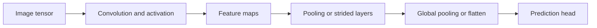

# Deep learning 2: images, convolution and transfer learning

[Subject home](../README.md) · [Theory index](README.md)

An image is an array of measurements. A grayscale image has one intensity channel; RGB has three colour channels; an alpha channel can represent transparency. In an 8-bit channel values commonly range from 0 to 255, but image formats and preprocessing vary. Dividing by 255 scales that range to [0,1]; it is not the same as fitting a general min-max transform to every image separately.

## On this page

- [1. Why convolution?](#1-why-convolution)
- [2. One convolution calculation](#2-one-convolution-calculation)
- [3. Shape, channels, padding and stride](#3-shape-channels-padding-and-stride)
- [4. Pooling and receptive fields](#4-pooling-and-receptive-fields)
- [5. Architecture families and the reason for their designs](#5-architecture-families-and-the-reason-for-their-designs)
- [6. Transfer learning](#6-transfer-learning)

## 1. Why convolution?

A dense network can read flattened pixels, but flattening does not explicitly preserve local spatial relationships. Convolution applies a small shared filter across locations. This gives local receptive fields and weight sharing. Learned early filters can detect edges and textures; deeper features combine patterns. These are learned representations, not a strict biological replica of visual cortex.

## 2. One convolution calculation

Take a 3×3 patch and a vertical-edge filter:

$$X=\begin{bmatrix}0&0&1\\0&0&1\\0&0&1\end{bmatrix},\quad K=\begin{bmatrix}1&0&-1\\2&0&-2\\1&0&-1\end{bmatrix}.$$

Multiply matching positions and add: $0+0-1+0+0-2+0+0-1=-4$. That is one response before adding a bias or activation. Reversing edge direction changes its sign. A CNN implementation usually uses cross-correlation (no filter reversal), although the layer is called convolution.

Do not individually rescale every feature map merely so a diagram looks like a new 8-bit image. Negative activations and their subsequent nonlinearities have mathematical meaning in the network.

## 3. Shape, channels, padding and stride

For input width n, filter width k, padding p, stride s and dilation one, output width is $\lfloor(n+2p-k)/s\rfloor+1$. Apply separately to height and width. A 6×6 image with a 3×3 filter, stride 1, no padding yields 4×4. Padding one on each side retains 6×6 in this example. Stride 2 moves two positions at a time and reduces resolution.

A filter spans **all input channels**. For RGB and a 3×3 kernel, one output-channel filter has $3\cdot3\cdot3=27$ weights, plus an optional bias. Twelve such filters have 336 parameters including biases, and produce twelve output channels. Padding preserves selected output dimensions; it does not recover all lost information. Odd kernels are convenient for a central pixel, not a universal correctness requirement.

## 4. Pooling and receptive fields

Max pooling keeps the largest activation in a window; average pooling averages it. For a patch $\begin{bmatrix}1&4\\2&3\end{bmatrix}$, max is 4 and mean is 2.5. Pooling reduces resolution and introduces some local shift tolerance; it is not complete translation invariance. Strided convolutions are another downsampling method.

Several 3×3 convolutions can enlarge the receptive field and add nonlinearities. Parameter comparisons must include input/output channel counts; comparing only “9+9 versus 25” ignores channel mixing. Flattening reshapes activations into a vector without deleting numerical entries, but a later dense layer no longer uses a grid-shaped local connection pattern. Global average pooling summarizes each channel and can reduce head parameters.

## 5. Architecture families and the reason for their designs

| Family | Learning idea |
|---|---|
| LeNet | Convolution, subsampling and a classifier for small images |
| AlexNet | Deeper convolutional processing with ReLU-style training |
| VGG | Repeated small filters; deep and parameter-heavy heads |
| Inception | Combine different receptive-field paths |
| ResNet | Residual/skip paths support training deeper models |

Depth alone is not a guarantee of accuracy. Input preprocessing, data, training and evaluation matter. An image classifier assigns a label to an image; object detection predicts boxes and classes; segmentation predicts pixel-level labels. They need different targets and evaluation metrics.

## 6. Transfer learning

Reuse a pretrained feature extractor, replace its prediction head for your target, and first train the new head. Optionally unfreeze selected backbone layers and fine-tune at a suitable learning rate. Freeze and fine-tune decisions depend on dataset size and domain difference; pretrained features may be less suitable for a very different image domain.

Split by subject or source where related images could otherwise leak between training and test. Augment only training images using transformations that preserve label meaning. A horizontal flip may be sensible for some object photos and wrong for text or left/right diagnoses. Report per-class errors and inspect failed images, not just aggregate accuracy.

**Practical task:** Trace every tensor shape in a small image model, count filter parameters including channels, and compare a simple baseline with a pretrained extractor using the same held-out data.

[← Neurons, activations, backpropagation and training](01-neural-networks.md) · [Language, vectors, RNN, LSTM and transformers →](03-nlp-and-sequences.md) · [Try the practicals](../02-practicals/README.md)
