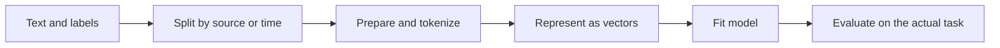
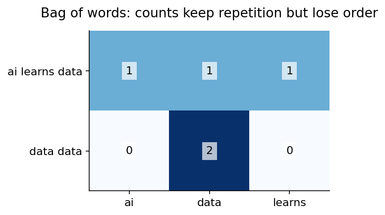
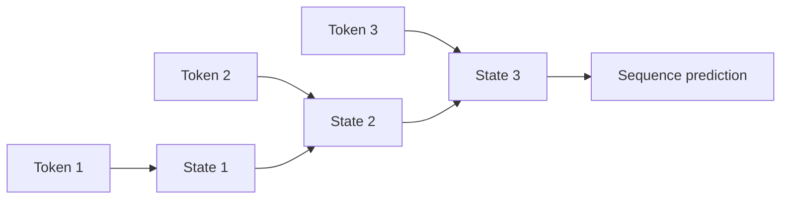

# Deep learning 3: language, vectors and sequence models

[Subject home](../README.md) · [Theory index](README.md)

Natural language processing works with human language: classification, extraction, search, translation, generation and question answering. Language is difficult because words are ambiguous and meaning depends on context. “Bank” can mean a financial institution or a river edge. Natural language processing should not be confused with the unrelated phrase “neuro-linguistic programming”.

## On this page

- [1. Build a task-specific text pipeline](#1-build-a-task-specific-text-pipeline)
- [2. Sparse representations with a calculation](#2-sparse-representations-with-a-calculation)
- [3. Dense embeddings](#3-dense-embeddings)
- [4. RNNs: carry a state across time](#4-rnns-carry-a-state-across-time)
- [5. LSTM gates and GRU](#5-lstm-gates-and-gru)
- [6. Attention, transformers and applications](#6-attention-transformers-and-applications)
- [7. Evaluate what the task needs](#7-evaluate-what-the-task-needs)

## 1. Build a task-specific text pipeline

A corpus is a collection of documents; a vocabulary is a set of tokens. Tokens can be words, subwords or characters. Syntax concerns structure, semantics concerns meaning, and pragmatics/context concerns use. Phonemes are sound units; morphemes are small meaningful units. A token is a modelling choice and need not equal any of them.

Clean only what the task permits: HTML removal, Unicode normalization, whitespace and duplicates can help, but punctuation, case and negation can carry meaning. Removing “not” can reverse sentiment. Stemming applies rough reduction rules; lemmatization uses linguistic information to identify a base form. Stop-word removal and lowercasing are optional design choices, not universal requirements for every transformer or embedding model.

## 2. Sparse representations with a calculation

For vocabulary `(ai, data, learns)`, one-hot `data` is `(0,1,0)`. Bag-of-words counts token occurrences. “ai learns data” becomes `(1,1,1)`; “data data” becomes `(0,2,0)`. The representation loses order: “dog bites man” and “man bites dog” have identical counts.

One possible unsmoothed TF-IDF convention is $tf(t,d)\log[N/df(t)]$. With three documents, a term in all three has IDF $\log1=0$; a term appearing in one has $\log3\approx1.099$. Libraries can smooth IDF, normalize vectors or use different TF rules; state the convention when doing hand calculations. Fit vocabulary/IDF on training documents, then transform validation/test without refitting.

Bigrams add short order patterns, such as “not good”, but expand vocabulary. A count/TF-IDF plus logistic or multinomial Naive Bayes model is a useful interpretable baseline. Choose the model based on validation, rather than assuming a larger network is necessary.

## 3. Dense embeddings

An embedding is a learned dense vector. Similarity can reflect training patterns and context; it is not guaranteed to encode every intended human concept. Static word embeddings give one vector per vocabulary item; contextual embeddings let a token's representation depend on its surrounding text. Subword tokenization reduces the need for a separate whole-word entry for every possible spelling.

Cosine similarity is a normalized dot product; review the linear-algebra guide for the calculation. An embedding model and its preprocessing define the vector space. Do not mix vectors from different model versions as if their coordinates were compatible. For document search, consider chunk boundaries, retrieval metrics and relevant context, not just vector similarity on a few hand-picked phrases.

## 4. RNNs: carry a state across time

An RNN shares parameters across sequence positions and updates a state:

$$h_t=\tanh(W_xx_t+W_hh_{t-1}+b).$$

For a scalar illustration with $W_x=W_h=1$, $b=0$, $h_0=0$ and inputs 1,0: $h_1=\tanh1\approx0.7616$, $h_2=\tanh0.7616\approx0.6420$. The second state depends on the earlier input. This is a compressed learned state, not exact storage of every past token.

Many-to-one predicts a review sentiment; many-to-many labels tokens or translates sequences; one-to-many can generate a sequence from a conditioning vector. Use masks for padded positions. Backpropagation through time differentiates the unrolled graph; long chains can have vanishing/exploding gradients. At inference, a causal next-token model must not use future tokens.

## 5. LSTM gates and GRU

An LSTM separates a cell state $c_t$ from an exposed hidden state $h_t$. Sigmoid gates control values in (0,1); a tanh candidate proposes content:

$$f_t=\sigma(\cdot),\quad i_t=\sigma(\cdot),\quad g_t=\tanh(\cdot),\quad o_t=\sigma(\cdot),$$
$$c_t=f_t\odot c_{t-1}+i_t\odot g_t,\qquad h_t=o_t\odot\tanh(c_t).$$

The dots stand for separate learned affine functions of $x_t$ and $h_{t-1}$. Forget, input and output **gates all use sigmoid** in the standard formulation; tanh is used for candidate content and exposing cell content. Gating helps retain information but does not guarantee arbitrarily long memory.

A GRU uses update/reset gates and a candidate state, with no separate LSTM-style cell state. Equations differ by implementation convention; conceptually the update gate mixes old state and proposed state. A bidirectional model reads both directions and can help whole-sentence analysis; it cannot be used unchanged when future context is unavailable.

## 6. Attention, transformers and applications

Attention forms weighted combinations of value vectors using query-key scores. The linear-algebra guide contains a full numerical attention example. A transformer combines attention with feed-forward layers, position information and normalization/residual paths; it is not simply an RNN with a larger memory cell. Encoder, decoder and causal-mask designs serve different tasks.

Named-entity recognition finds spans and types; information retrieval ranks relevant items; topic modelling discovers statistical themes; translation maps between languages; summarization condenses while preserving meaning. Topic models such as LDA/NMF and document clusters require human interpretation. Generated answers need factual and task checks; fluent wording is not proof of correctness.

## 7. Evaluate what the task needs

For classification, examine precision/recall and class errors. For extraction, check exact or overlap-based span rules. For retrieval, measure whether relevant items are retrieved/ranked. For generation, evaluate factuality, instruction following and useful completion, with task-appropriate human review. Intrinsic representation scores can be helpful, but downstream/extrinsic performance answers whether the system actually works.

Use source/group/time splits to avoid duplicate-document leakage. Inspect language, dialect and rare-case performance. Keep training and serving preprocessing consistent. The practicals contain preprocessing, embeddings, sentiment and sequence exercises; start with the smallest example before attempting a complete application.

[← Images, convolution and transfer learning](02-computer-vision.md) · [Try the practicals](../02-practicals/README.md)
