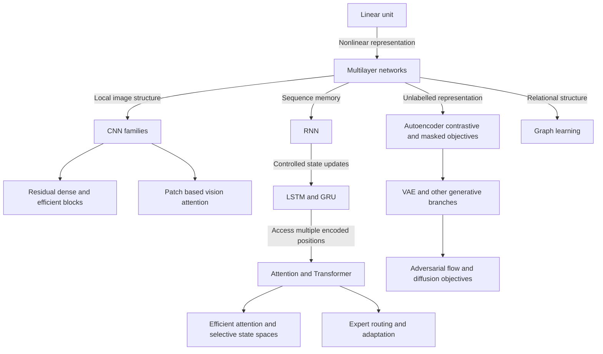

# The deep-learning story: representation, memory, optimization and generation

[Subject home](../README.md) · [Foundation course](README.md) · [Practicals](../02-practicals/README.md)

Begin with tensors and training, then use this branching map. Historical motivations help explain designs, but different tasks, objectives and compute constraints create alternatives rather than one inevitable successor chain.

## Follow the branches in this reading order

### 01. [From a perceptron to multilayer networks](algorithms/01-perceptron-to-mlp.md)

**Problem:** A linear threshold unit can separate classes with a straight boundary but cannot represent every simple classification pattern.

**Change:** A perceptron computes a score $w^Tx+b$ and applies a threshold.

**Still consider:** An MLP is flexible and general but ignores useful image/sequence structure unless learned from data.

### 02. [SGD, momentum, adaptive optimizers, normalization and transfer](algorithms/02-optimization-and-training-history.md)

**Problem:** A representable function can still be hard to train.

**Change:** SGD uses sampled gradients.

**Still consider:** New training recipes may improve speed/stability under a workload but can trade memory, numerical behaviour and sensitivity.

### 03. [LeNet, AlexNet, VGG and Inception: learning local visual structure](algorithms/03-cnn-family.md)

**Problem:** Dense layers do not automatically exploit the fact that nearby image pixels form reusable patterns.

**Change:** A convolution applies learned kernels across positions/channels.

**Still consider:** Locality/sharing can improve sample/compute efficiency, but ordinary CNNs have limited built-in global interaction and can learn spurious textures.

### 04. [ResNet, DenseNet, MobileNet, EfficientNet, detection and segmentation](algorithms/04-residual-efficient-and-vision-tasks.md)

**Problem:** Making a plain network deeper can make optimization worse rather than improve fit.

**Change:** A residual block returns $x+F(x)$, with a projection when shapes differ.

**Still consider:** Residual paths ease selected training problems, dense reuse can help information flow, and separable blocks reduce arithmetic.

### 05. [Vision Transformers, contrastive image–text models and multimodal systems](algorithms/05-vision-and-multimodal-transformers.md)

**Problem:** CNN locality is useful but may require many layers to connect distant visual regions.

**Change:** A Vision Transformer splits an image into patches, projects flattened patches to embeddings, adds positional information and processes tokens with Transformer blocks.

**Still consider:** Global interactions and transferable paired representations are strengths; data scale, patch detail loss, computation, prompt sensitivity and dataset biases remain.

### 06. [CBOW, skip-gram, GloVe, FastText and contextual language models](algorithms/06-word-vectors-and-context.md)

**Problem:** Count vectors treat words as separate dimensions and can be sparse.

**Change:** Word 2Vec CBOW predicts a target from surrounding context; skip-gram predicts context from a target.

**Still consider:** Static embeddings are compact/reusable but limited by context ambiguity and corpus bias.

### 07. [RNN → gated memory: LSTM and GRU](algorithms/07-rnn-lstm-gru.md)

**Problem:** Independent-input models ignore sequence context.

**Change:** An RNN updates $h_t=\phi(W_xx_t+W_hh_{t-1}+b)$.

**Still consider:** Gating helps selected memory/optimization patterns, but recurrence still processes dependent steps and can struggle with long contexts.

### 08. [Encoder–decoder → attention → Transformer → BERT/GPT/T5](algorithms/08-seq2seq-attention-transformer.md)

**Problem:** A sequence-to-sequence model compressing a whole input into one fixed representation can lose information, especially on long inputs.

**Change:** Encoder–decoder recurrence encodes a source and generates a target.

**Still consider:** Attention supports content-based long-range interaction and parallel training, but quadratic full attention, positional generalization, factual grounding and data requirements remain.

### 09. [Efficient attention, S4/Mamba, mixture-of-experts and adaptation](algorithms/09-efficient-sequence-and-experts.md)

**Problem:** Long-context attention and always-active large dense networks can be expensive.

**Change:** Sparse/windowed attention restricts selected interactions; low-rank/kernel-style approaches approximate selected attention computations.

**Still consider:** Efficiency mechanisms trade exactness, connectivity, state capacity, precision or operational complexity in different ways.

### 10. [Autoencoders, VAEs, contrastive learning and masked representation learning](algorithms/10-representations-and-self-supervision.md)

**Problem:** Labelled examples can be scarce.

**Change:** An autoencoder minimizes reconstruction loss through an encoder/decoder bottleneck.

**Still consider:** Self-supervision can exploit unlabelled data and transfer representations; false positives/negatives in view construction, domain shift, shortcut learning and evaluation leakage remain.

### 11. [Autoregressive models, GANs, flows and diffusion](algorithms/11-generative-branches.md)

**Problem:** A model can learn a distribution for generation rather than only a label or point estimate.

**Change:** Autoregressive generation factorizes a joint distribution into conditional predictions and samples sequentially.

**Still consider:** Autoregression offers explicit sequential factors but can sample slowly; GANs can generate quickly but omit modes; flows offer tractable density under invertibility constraints; diffusion often uses iterative sampling with quality/latency trade-offs.

### 12. [Graph convolution, message passing, GAT and graph transformers](algorithms/12-graph-learning.md)

**Problem:** Independent rows and regular image grids do not naturally represent arbitrary relationships among entities.

**Change:** Message-passing networks update a node from its own state and aggregated neighbour messages.

**Still consider:** Graph models encode relational structure and can share evidence, but graph construction/sampling and leakage often dominate.

## How to compare alternatives

Use the same task, eligible data, split/horizon and compute budget. State the objective, assumptions, training/update procedure, important settings and failure cases. A newer publication can address one bottleneck while being worse on another. A survey row identifies a family; it does not pretend to derive every research variant.

For a method you study, complete this sentence: “I would consider it because ___; it works by ___; I would compare it with ___ using ___; I would avoid or investigate it when ___.” Recalculate the worked examples before selecting by a method name.
