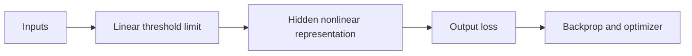

# 01 — From a perceptron to multilayer networks

[Algorithm story](../ALGORITHM-STORY.md) · [Algorithm index](README.md) · [Practicals](../../02-practicals/README.md)

## On this page

- [1. Why this branch exists](#1-why-this-branch-exists)
- [2. How it works and learns](#2-how-it-works-and-learns)
- [3. Calculate a small example](#3-calculate-a-small-example)
- [4. Advantages, limitations and related alternatives](#4-advantages-limitations-and-related-alternatives)
- [5. How to choose and validate it](#5-how-to-choose-and-validate-it)

## 1. Why this branch exists

A linear threshold unit can separate classes with a straight boundary but cannot represent every simple classification pattern. Hidden nonlinear layers address representational limits; differentiable training addresses a different challenge: how to learn those layers.

## 2. How it works and learns

A perceptron computes a score $w^Tx+b$ and applies a threshold. A classic mistake-driven update for a misclassified example with labels ±1 is $w\leftarrow w+\eta yx$, with a corresponding bias update. Its convergence result needs linearly separable data and other standard conditions; it does not promise convergence on arbitrary labels.

A multilayer perceptron composes affine maps and nonlinear activations. Hidden units partition/transform the representation so a final layer can solve a boundary that was not linear in the original coordinates. Backprop computes chain-rule gradients; an optimizer changes weights under an explicit loss. Classification probabilities and margins require suitable heads/objectives rather than being intrinsic to every neural unit.

## 3. Calculate a small example

XOR labels(0,0)→0,(0,1)→1,(1,0)→1,(1,1)→0 cannot be separated by one straight boundary. As a constructive illustration, let $h_1=1[x_1+x_2>.5]$, $h_2=1[x_1+x_2>1.5]$; output $h_1-h_2$ equals XOR on those four binary inputs. This threshold construction shows representational power, not a claim that ordinary gradient descent differentiates those thresholds directly.

Smooth/ReLU hidden units with a proper loss provide a trainable modern formulation. Depth adds composition but also optimization and data requirements.

## 4. Advantages, limitations and related alternatives

An MLP is flexible and general but ignores useful image/sequence structure unless learned from data. Parameter count grows with dense connections, and deep nonlinear optimization can be unstable. CNNs introduce locality/sharing for images; recurrent/attention models introduce sequence-related structure. They are task-informed alternatives rather than simply “more intelligent” MLPs.

## 5. How to choose and validate it

Choose width/depth, activation, head/loss, initialization and regularization under a valid split. Compare simple linear/tree models on tabular tasks; inspect training/validation curves and tensor shapes. Complexity without evidence is not progress.

---

[SGD, momentum, adaptive optimizers, normalization and transfer →](02-optimization-and-training-history.md)
