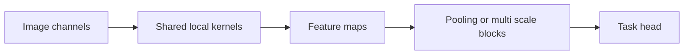

# 03 — LeNet, AlexNet, VGG and Inception: learning local visual structure

[Algorithm story](../ALGORITHM-STORY.md) · [Algorithm index](README.md) · [Practicals](../../02-practicals/README.md)

## On this page

- [1. Why this branch exists](#1-why-this-branch-exists)
- [2. How it works and learns](#2-how-it-works-and-learns)
- [3. Calculate a small example](#3-calculate-a-small-example)
- [4. Advantages, limitations and related alternatives](#4-advantages-limitations-and-related-alternatives)
- [5. How to choose and validate it](#5-how-to-choose-and-validate-it)

## 1. Why this branch exists

Dense layers do not automatically exploit the fact that nearby image pixels form reusable patterns. Convolution shares local detectors. Different CNN designs then trade depth, receptive fields, branching and compute rather than forming a single universal replacement chain.

## 2. How it works and learns

A convolution applies learned kernels across positions/channels. The stored weights are shared, reducing parameters relative to a dense image mapping. Pooling/stride changes resolution; receptive field describes which input positions can influence an output. Neural libraries commonly implement cross-correlation while using the name convolution.

LeNet-style systems illustrate convolution/pooling for compact vision tasks. AlexNet popularized a deeper large-scale CNN training recipe including ReLU/GPU-era training choices. VGG emphasizes stacks of small filters and a simple repeated design, but can be parameter/compute heavy. Inception uses parallel branches with different transformations and bottleneck projections to combine representations at controlled cost. These design summaries are not a guarantee that a named old checkpoint suits a new dataset.

## 3. Calculate a small example

A3×3 kernel with 3 input channels and 8 output filters has $8(3\cdot3\cdot3+1)=224$ parameters with biases. Two stride 1 3×3 layers have a 5×5 spatial receptive field in the simple no-dilation setting, while adding an intervening nonlinearity.

A1×1 convolution mixes channels at each position: it is not spatially useless merely because it sees one location. It can reduce channels before a more expensive spatial kernel.

## 4. Advantages, limitations and related alternatives

Locality/sharing can improve sample/compute efficiency, but ordinary CNNs have limited built-in global interaction and can learn spurious textures. Greater depth creates optimization issues; residual connections address selected issues. Detection and segmentation also need spatial outputs, not just an image classifier head.

## 5. How to choose and validate it

Tune input normalization/resolution, strides, channel widths, augmentation and transfer strategy. Split by patient/source/video when needed. Compare parameter count, FLOPs, actual latency and quality; architecture names alone do not determine deployment cost.

---

[← SGD, momentum, adaptive optimizers, normalization and transfer](02-optimization-and-training-history.md) · [ResNet, DenseNet, MobileNet, EfficientNet, detection and segmentation →](04-residual-efficient-and-vision-tasks.md)
