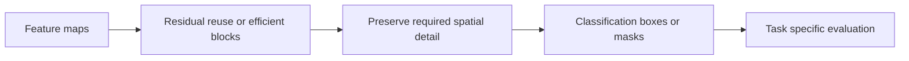
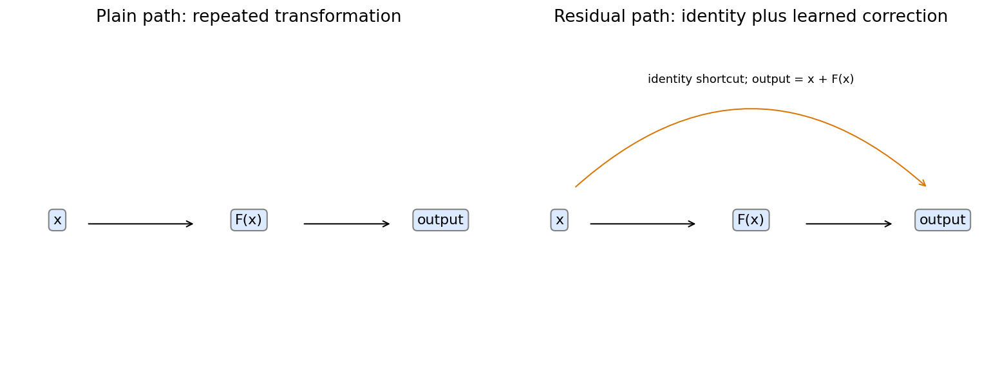
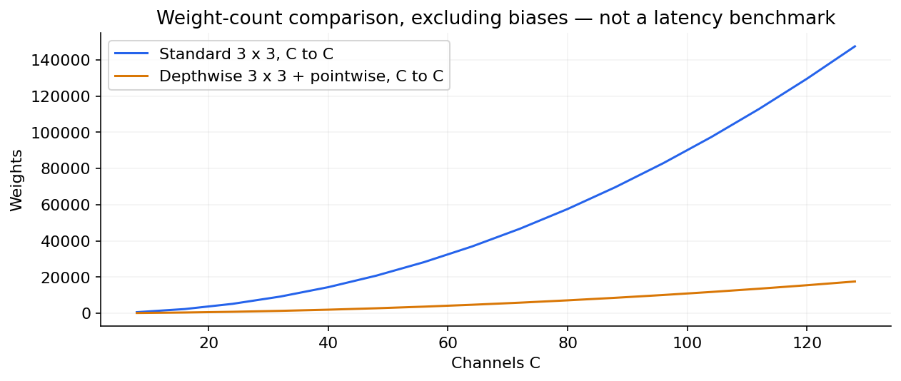

# 04 — ResNet, DenseNet, MobileNet, EfficientNet, detection and segmentation

[Algorithm story](../ALGORITHM-STORY.md) · [Algorithm index](README.md) · [Practicals](../../02-practicals/README.md)

## On this page

- [1. Why this branch exists](#1-why-this-branch-exists)
- [2. How it works and learns](#2-how-it-works-and-learns)
- [3. Calculate a small example](#3-calculate-a-small-example)
- [4. Advantages, limitations and related alternatives](#4-advantages-limitations-and-related-alternatives)
- [5. How to choose and validate it](#5-how-to-choose-and-validate-it)

## 1. Why this branch exists

Making a plain network deeper can make optimization worse rather than improve fit. Large CNNs can also be too costly for a device. Shortcut and efficiency designs tackle different limitations, while detection/segmentation change the output task.

## 2. How it works and learns

A residual block returns $x+F(x)$, with a projection when shapes differ. Gradients have an identity-path contribution, helping optimization; residuals do not guarantee nonvanishing gradients everywhere. DenseNet concatenates earlier feature maps for later reuse instead of using the same additive shortcut design. More connectivity can increase memory use.

Depthwise-separable convolution applies spatial filtering per channel then pointwise channel mixing; MobileNet-style families exploit this and related bottleneck designs. EfficientNet studies coordinated scaling of depth/width/resolution under a compute budget. These are efficiency/representation choices, not a claim that one architecture dominates on every hardware backend.

For detection, R-CNN-style two-stage systems propose regions and classify/refine them; YOLO/SSD-style families pursue single-stage prediction; DETR-style approaches use set prediction and matching-based training. For segmentation, FCN/U-Net/DeepLab-style families preserve/recover spatial outputs using skip connections, multiscale or dilated operations. Exact designs vary by version.

A residual block provides an additive identity route.

Fewer weights do not automatically mean lower measured latency.

## 3. Calculate a small example

With C input/output channels and spatial kernel k, a standard convolution has about $k^2C^2$ weights. A depthwise+pointwise design has about $k^2C+C^2$, excluding biases. For k=3,C=32, this is 9216 versus 1312. Actual speed depends on kernels/memory/hardware, not just weight count.

A predicted box is evaluated by overlap/localization and class quality; a pixel mask has a different unit. Classification accuracy cannot stand in for either task's metrics.

## 4. Advantages, limitations and related alternatives

Residual paths ease selected training problems, dense reuse can help information flow, and separable blocks reduce arithmetic. They add design/hardware trade-offs. Vision transformers explore global token interactions with different data/compute biases. New task heads and objectives are not merely “better classifiers”.

## 5. How to choose and validate it

Evaluate the actual task: detection AP with stated IoU conventions, segmentation IoU/Dice with class definitions, latency/memory and subgroup robustness. Use [the ResNet paper](https://arxiv.org/abs/1512.03385) for its optimization motivation rather than claiming every later model was caused by one weakness.

---

[← LeNet, AlexNet, VGG and Inception: learning local visual structure](03-cnn-family.md) · [Vision Transformers, contrastive image–text models and multimodal systems →](05-vision-and-multimodal-transformers.md)
