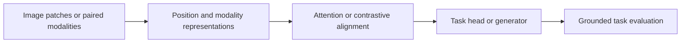

# 05 — Vision Transformers, contrastive image–text models and multimodal systems

[Algorithm story](../ALGORITHM-STORY.md) · [Algorithm index](README.md) · [Practicals](../../02-practicals/README.md)

## On this page

- [1. Why this branch exists](#1-why-this-branch-exists)
- [2. How it works and learns](#2-how-it-works-and-learns)
- [3. Calculate a small example](#3-calculate-a-small-example)
- [4. Advantages, limitations and related alternatives](#4-advantages-limitations-and-related-alternatives)
- [5. How to choose and validate it](#5-how-to-choose-and-validate-it)

## 1. Why this branch exists

CNN locality is useful but may require many layers to connect distant visual regions. Token attention offers another image representation. Combining image and language introduces alignment tasks rather than just a larger image classifier.

## 2. How it works and learns

A Vision Transformer splits an image into patches, projects flattened patches to embeddings, adds positional information and processes tokens with Transformer blocks. A task head pools selected information for prediction. Hierarchical/windowed vision-transformer families reduce cost and introduce local/multiscale structure; pure global attention is not the only design.

Contrastive image–text training, as in the CLIP family, aligns image/text representations using paired data and alternatives in a defined objective. Zero-shot classification can compare an image embedding with prompted class-text embeddings. This tests alignment, not a guaranteed open-world recognition oracle. Multimodal generative systems combine an encoder/projection or other modality interfaces with a language model and training objectives; exact designs vary.

## 3. Calculate a small example

A224×224 image with 16×16 nonoverlapping patches yields 14×14=196 patch tokens before optional special tokens. Full pairwise attention over 196 patches has 38416 score entries per head. Different patch sizes trade local detail, token count and cost.

If an image of an ambiguous product aligns more with“red bag”than“red box”, that relative similarity is a model result. It is not an independently calibrated probability or proof that text in the image was read correctly.

## 4. Advantages, limitations and related alternatives

Global interactions and transferable paired representations are strengths; data scale, patch detail loss, computation, prompt sensitivity and dataset biases remain. CNN/hybrid models can be stronger under selected resource/data constraints. A multimodal assistant can still hallucinate visual details or obey malicious text without host-level controls.

## 5. How to choose and validate it

Evaluate classification/retrieval/grounded generation separately, including rare objects, OCR, spatial relations, adversarial text and domain shift. Compare actual input resolution, memory and latency. Match the head/objective to the requested task rather than assuming every vision transformer is a detector or generator.

Primary designs: [Vision Transformer](https://arxiv.org/abs/2010.11929) for patch-based image classification and [CLIP](https://arxiv.org/abs/2103.00020) for paired image–text representation learning.

---

[← ResNet, DenseNet, MobileNet, EfficientNet, detection and segmentation](04-residual-efficient-and-vision-tasks.md) · [CBOW, skip-gram, GloVe, FastText and contextual language models →](06-word-vectors-and-context.md)
