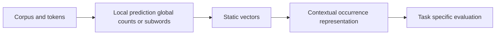

# 06 — CBOW, skip-gram, GloVe, FastText and contextual language models

[Algorithm story](../ALGORITHM-STORY.md) · [Algorithm index](README.md) · [Practicals](../../02-practicals/README.md)

## On this page

- [1. Why this branch exists](#1-why-this-branch-exists)
- [2. How it works and learns](#2-how-it-works-and-learns)
- [3. Calculate a small example](#3-calculate-a-small-example)
- [4. Advantages, limitations and related alternatives](#4-advantages-limitations-and-related-alternatives)
- [5. How to choose and validate it](#5-how-to-choose-and-validate-it)

## 1. Why this branch exists

Count vectors treat words as separate dimensions and can be sparse. Learned distributed vectors share statistical information, but one static vector cannot distinguish every meaning of a word. Contextual models address that ambiguity with a different training/representation setup.

## 2. How it works and learns

Word 2Vec CBOW predicts a target from surrounding context; skip-gram predicts context from a target. Negative sampling trains selected observed-versus-noise pair distinctions efficiently rather than calculating a complete vocabulary normalization for every pair. The learned vectors depend on corpus/window/objective choices.

GloVe fits vector relationships to global co-occurrence statistics under a weighted log-count regression objective. FastText-style subword modelling composes selected character n-gram information, helping with morphology and some unseen forms, though not magically solving every language or rare-word problem. Static methods produce a token-type representation; contextual encoders/decoders compute a token occurrence representation from surrounding permitted context.

BERT's bidirectional masked setup and GPT's causal next-token setup use different context availability. Sentence/document embeddings require a pooling/training strategy; simply averaging arbitrary hidden states is not a universal semantic search method. Evaluate similarity on the actual retrieval/classification task.

## 3. Calculate a small example

“bank”in“river bank”and“bank account”has one token-type vector in an ordinary static model, while contextual representations can differ. A subword model may share parts among“learn”,“learner”and“learning”, but shared spelling does not guarantee shared meaning.

Cosine 1 for vectors(1,0) and(2,0) means matching direction, not identical frequency, magnitude or factual content.

## 4. Advantages, limitations and related alternatives

Static embeddings are compact/reusable but limited by context ambiguity and corpus bias. Contextual models are more expressive but more expensive and still learn biases/shortcuts. Retrieval-trained embeddings and cross-encoder rerankers serve different roles. Similar-looking vectors do not make claims true.

## 5. How to choose and validate it

Choose tokenization, corpus, vocabulary/subwords, context window, objective and downstream evaluation. Check document duplication, language/domain shift and embedding-version compatibility. Preserve the distinction between a representation method and an entire language-generation system.

---

[← Vision Transformers, contrastive image–text models and multimodal systems](05-vision-and-multimodal-transformers.md) · [RNN → gated memory: LSTM and GRU →](07-rnn-lstm-gru.md)
