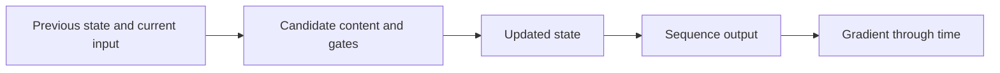
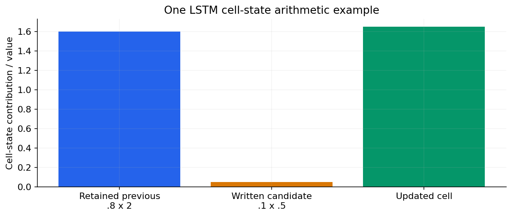

# 07 — RNN → gated memory: LSTM and GRU

[Algorithm story](../ALGORITHM-STORY.md) · [Algorithm index](README.md) · [Practicals](../../02-practicals/README.md)

## On this page

- [1. Why this branch exists](#1-why-this-branch-exists)
- [2. How it works and learns](#2-how-it-works-and-learns)
- [3. Calculate a small example](#3-calculate-a-small-example)
- [4. Advantages, limitations and related alternatives](#4-advantages-limitations-and-related-alternatives)
- [5. How to choose and validate it](#5-how-to-choose-and-validate-it)

## 1. Why this branch exists

Independent-input models ignore sequence context. Recurrent state adds memory, but gradients through many repeated steps can vanish or explode. LSTM/GRU introduce controlled state updates; they do not make memory unlimited.

## 2. How it works and learns

An RNN updates $h_t=\phi(W_xx_t+W_hh_{t-1}+b)$. Backpropagation through time accounts for shared parameters across steps. LSTM uses a cell-state path with gates; a standard update is $c_t=f_t\odot c_{t-1}+i_t\odot\tilde c_t$, with output gate controlling the exposed state. Forget/input/output gates commonly use sigmoid and candidate content tanh.

GRU merges aspects of cell/hidden-state handling with reset/update gating and fewer separate state components. Its exact parameter efficiency/performance depends on dimensions/task. Gradient clipping limits gradient magnitude but does not reconstruct missing long-range information. Bidirectional recurrence reads both directions and is valid only when both directions are available for the task.

Retained cell state and written candidate content add to 1.65.

## 3. Calculate a small example

If previous cell 2, forget gate.8, input gate.1 and candidate.5, updated cell is $.8(2)+.1(.5)=1.65$. The model learns gate values from inputs/state; they are not hand-set “percent memory” guarantees across all data.

The derivative along a simplified repeated scalar path may contain a product like $.5^{20}\approx9.54\times10^{-7}$. This illustrates vanishing signal, not the full derivative formula for every RNN.

## 4. Advantages, limitations and related alternatives

Gating helps selected memory/optimization patterns, but recurrence still processes dependent steps and can struggle with long contexts. Attention lets a decoder access multiple encoded positions, reducing a fixed-vector bottleneck. Transformers remove ordinary sequential recurrence in their standard core, gaining training parallelism but paying attention memory/cost.

## 5. How to choose and validate it

Tune context length, hidden size, masking, sequence batching, optimizer and clipping under realistic evaluation. Ensure hidden state does not cross unrelated sequences. Evaluate generated sequences rather than only teacher-forced loss.

---

[← CBOW, skip-gram, GloVe, FastText and contextual language models](06-word-vectors-and-context.md) · [Encoder–decoder → attention → Transformer → BERT/GPT/T5 →](08-seq2seq-attention-transformer.md)
