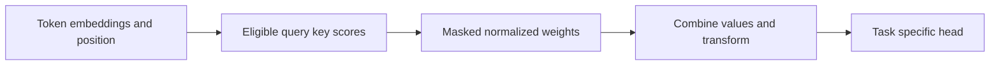

# 08 — Encoder–decoder → attention → Transformer → BERT/GPT/T5

[Algorithm story](../ALGORITHM-STORY.md) · [Algorithm index](README.md) · [Practicals](../../02-practicals/README.md)

## On this page

- [1. Why this branch exists](#1-why-this-branch-exists)
- [2. How it works and learns](#2-how-it-works-and-learns)
- [3. Calculate a small example](#3-calculate-a-small-example)
- [4. Advantages, limitations and related alternatives](#4-advantages-limitations-and-related-alternatives)
- [5. How to choose and validate it](#5-how-to-choose-and-validate-it)

## 1. Why this branch exists

A sequence-to-sequence model compressing a whole input into one fixed representation can lose information, especially on long inputs. Attention gives the decoder selective access. Transformers reorganize that interaction without ordinary recurrent processing in their standard blocks.

## 2. How it works and learns

Encoder–decoder recurrence encodes a source and generates a target. Attention computes query-to-key scores, normalizes eligible positions and combines values. Scaled dot-product attention is $softmax(QK^T/\sqrt{d_k})V$. Multiple heads, positional information, feed-forward layers, residual connections and normalization form the standard Transformer design.

Encoder-style BERT uses bidirectional contextual representations with a masked-training setup. GPT-style causal decoders predict next tokens from prior context. T5-style systems use an encoder–decoder text-to-text approach with its chosen pretraining objective. These are objective/architecture branches, not “BERT failed, therefore GPT replaced it”. RoBERTa-style training changes and other variants further separate training recipe from architecture.

## 3. Calculate a small example

Scores[0,ln 3]normalize to[.25,.75]. Values[2,6]combine to 5. A causal mask that excludes the second key produces 2 instead. The mask encodes information availability, not merely a formatting preference.

For length n, full self-attention has n²query-key entries per head. Doubling context quadruples these entries; optimized implementations can change memory/execution efficiency without changing every underlying interaction.

## 4. Advantages, limitations and related alternatives

Attention supports content-based long-range interaction and parallel training, but quadratic full attention, positional generalization, factual grounding and data requirements remain. Efficient attention, retrieval, state-space models and sparse expert computation address different bottlenecks. A longer context is not proof the model uses every relevant detail.

## 5. How to choose and validate it

Match architecture/objective to classification, extraction, generation or translation. Test masks, leakage, tokenization, long inputs and task metrics. Primary historical design: [Attention Is All You Need](https://arxiv.org/abs/1706.03762); compare modern implementations against their own documented versions.

---

[← RNN → gated memory: LSTM and GRU](07-rnn-lstm-gru.md) · [Efficient attention, S4/Mamba, mixture-of-experts and adaptation →](09-efficient-sequence-and-experts.md)
