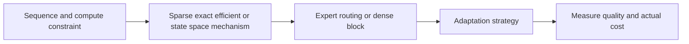

# 09 — Efficient attention, S4/Mamba, mixture-of-experts and adaptation

[Algorithm story](../ALGORITHM-STORY.md) · [Algorithm index](README.md) · [Practicals](../../02-practicals/README.md)

## On this page

- [1. Why this branch exists](#1-why-this-branch-exists)
- [2. How it works and learns](#2-how-it-works-and-learns)
- [3. Calculate a small example](#3-calculate-a-small-example)
- [4. Advantages, limitations and related alternatives](#4-advantages-limitations-and-related-alternatives)
- [5. How to choose and validate it](#5-how-to-choose-and-validate-it)

## 1. Why this branch exists

Long-context attention and always-active large dense networks can be expensive. Several branches reduce memory/computation or change sequence memory; they are not one linear progression and do not solve identical problems.

## 2. How it works and learns

Sparse/windowed attention restricts selected interactions; low-rank/kernel-style approaches approximate selected attention computations. FlashAttention-style algorithms reorganize exact attention computation to improve hardware I/O efficiency under their supported settings; they are not simply a smaller learned attention matrix.

Structured state-space sequence models such as S4 explore efficient recurrent/convolutional representations of dynamics. Mamba introduces input-dependent selective state-space processing with an efficient implementation; its linear-in-sequence-length characterization is not a guarantee that every workload/hardware beats attention. Hybrid designs combine mechanisms.

Mixture-of-experts routes token representations to selected expert subnetworks, increasing total parameter capacity without activating every expert each time. Routing balance, communication and serving complexity matter. LoRA adapts weights using a low-rank update $\Delta W=BA$; quantization lowers numerical precision; distillation trains a student from a teacher. They are training/serving strategies, not successors to the same architecture.

## 3. Calculate a small example

For a 1024×1024 weight matrix, a rank 8 LoRA pair has $1024(8)+8(1024)=16384$ trainable update parameters rather than 1048576 full entries, before any scaling/bias choices. The base matrix still exists; parameter-efficient adaptation does not mean the complete model has only 16384 parameters.

A top 2 expert router with 8 experts activates a subset, but shared layers and communication still cost compute.

## 4. Advantages, limitations and related alternatives

Efficiency mechanisms trade exactness, connectivity, state capacity, precision or operational complexity in different ways. Compression can harm quality/calibration. A small fine-tuning set can still overfit. Research comparisons require matched data, budgets and evaluation, not parameter-count headlines.

## 5. How to choose and validate it

Test quality versus actual latency/memory, supported contexts, training stability and deployment hardware. Distinguish total/active/trainable parameters. Primary selective-state-space reference: [Mamba](https://arxiv.org/abs/2312.00752).

Primary designs: [FlashAttention](https://arxiv.org/abs/2205.14135) for I/O-aware exact attention and [LoRA](https://arxiv.org/abs/2106.09685) for low-rank adaptation.

---

[← Encoder–decoder → attention → Transformer → BERT/GPT/T5](08-seq2seq-attention-transformer.md) · [Autoencoders, VAEs, contrastive learning and masked representation learning →](10-representations-and-self-supervision.md)
