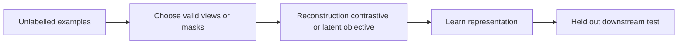

# 10 — Autoencoders, VAEs, contrastive learning and masked representation learning

[Algorithm story](../ALGORITHM-STORY.md) · [Algorithm index](README.md) · [Practicals](../../02-practicals/README.md)

## On this page

- [1. Why this branch exists](#1-why-this-branch-exists)
- [2. How it works and learns](#2-how-it-works-and-learns)
- [3. Calculate a small example](#3-calculate-a-small-example)
- [4. Advantages, limitations and related alternatives](#4-advantages-limitations-and-related-alternatives)
- [5. How to choose and validate it](#5-how-to-choose-and-validate-it)

## 1. Why this branch exists

Labelled examples can be scarce. Representation learning uses reconstruction, latent-variable modelling or relationships among views to learn features. Different objectives preserve different information; there is no universal “best embedding”.

## 2. How it works and learns

An autoencoder minimizes reconstruction loss through an encoder/decoder bottleneck. It may learn useful compression, but a sufficiently flexible network can reconstruct unhelpful details. A VAE parameterizes an approximate latent posterior and optimizes an evidence-lower-bound objective balancing expected reconstruction log likelihood and KL divergence to a prior; it is not merely an autoencoder with random noise added anywhere.

Contrastive methods such as SimCLR/MoCo-style families use positive/negative view relationships; BYOL-style methods explore noncontrastive target/online networks with anti-collapse design; masked autoencoding/language modelling predicts hidden parts. Augmentations and masking determine which invariances/information the representation learns. A transformation that changes the true task meaning can teach the wrong invariance.

## 3. Calculate a small example

If two views of the same image differ only by a valid crop, their embeddings can be encouraged to agree. If a crop removes the only object identifying a rare class, that assumption may fail. An InfoNCE-style objective uses $-\log[\exp(sim(z,z^+)/\tau)/\sum_j\exp(sim(z,z_j)/\tau)]$ under a specified candidate convention.

A reconstruction error near zero does not prove semantic understanding; an identity-like mapping can reconstruct without useful compression or anomaly discrimination.

## 4. Advantages, limitations and related alternatives

Self-supervision can exploit unlabelled data and transfer representations; false positives/negatives in view construction, domain shift, shortcut learning and evaluation leakage remain. Reconstruction, contrastive and masked objectives are alternatives with different biases. Downstream fine-tuning may add task information but also forget or overfit.

## 5. How to choose and validate it

Evaluate frozen-feature and adapted performance on genuine held-out labels, with task-appropriate splits. Audit pretraining overlap, augmentations, representation collapse and subgroup coverage. Never claim a representation is universally useful from one visually separated embedding plot.

---

[← Efficient attention, S4/Mamba, mixture-of-experts and adaptation](09-efficient-sequence-and-experts.md) · [Autoregressive models, GANs, flows and diffusion →](11-generative-branches.md)
