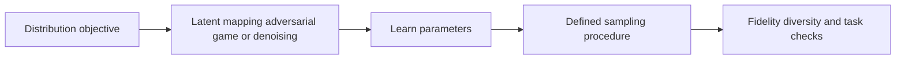

# 11 — Autoregressive models, GANs, flows and diffusion

[Algorithm story](../ALGORITHM-STORY.md) · [Algorithm index](README.md) · [Practicals](../../02-practicals/README.md)

## On this page

- [1. Why this branch exists](#1-why-this-branch-exists)
- [2. How it works and learns](#2-how-it-works-and-learns)
- [3. Calculate a small example](#3-calculate-a-small-example)
- [4. Advantages, limitations and related alternatives](#4-advantages-limitations-and-related-alternatives)
- [5. How to choose and validate it](#5-how-to-choose-and-validate-it)

## 1. Why this branch exists

A model can learn a distribution for generation rather than only a label or point estimate. Different generative families choose different likelihoods, latent representations and sampling procedures; they are not a sequence in which every newer method makes earlier ones useless.

## 2. How it works and learns

Autoregressive generation factorizes a joint distribution into conditional predictions and samples sequentially. VAEs use latent-variable inference with a tractable bound. GANs train a generator against a discriminator under an adversarial objective; mode collapse/instability can reduce coverage. Normalizing flows use invertible transformations and a Jacobian determinant to track density, imposing architectural constraints.

Diffusion/score-based models learn denoising or score-related predictions over noise levels and use a reverse generative procedure. A common noise-prediction training form is expected squared error $\mathbb E\|\epsilon-\epsilon_\theta(x_t,t)\|^2$ under a defined noising process. Latent diffusion moves selected computation into a learned compressed space. Flow-matching/rectified-flow families learn transport/vector-field objectives under their own path definitions; exact equivalences require assumptions rather than a shared marketing label.

## 3. Calculate a small example

A simplified noising equation is $x_t=\sqrt{\bar\alpha_t}x_0+\sqrt{1-\bar\alpha_t}\epsilon$. With scalar x 0=2, alpha-bar.64 and noise 1, xt=.8(2)+.6(1)=2.2. Predicting the added noise contributes to training, but this one equation is not the entire sampling algorithm.

For an invertible scalar transform y=2 x, density changes by the inverse scale factor. Tracking that change-of-variables term is central to a flow's likelihood.

## 4. Advantages, limitations and related alternatives

Autoregression offers explicit sequential factors but can sample slowly; GANs can generate quickly but omit modes; flows offer tractable density under invertibility constraints; diffusion often uses iterative sampling with quality/latency trade-offs. Fidelity, diversity, likelihood and usefulness are not interchangeable measures.

## 5. How to choose and validate it

Choose evaluation for the modality/task, including diversity, data memorization, factual support and permitted use. Compare sampling budget and resources honestly. Avoid claiming a low reconstruction loss or impressive image proves a calibrated or universally correct generative distribution.

Primary diffusion reference: [Denoising Diffusion Probabilistic Models](https://arxiv.org/abs/2006.11239). Different generative branches have their own objectives and should not be treated as interchangeable implementations.

---

[← Autoencoders, VAEs, contrastive learning and masked representation learning](10-representations-and-self-supervision.md) · [Graph convolution, message passing, GAT and graph transformers →](12-graph-learning.md)
