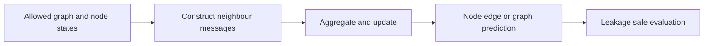

# 12 — Graph convolution, message passing, GAT and graph transformers

[Algorithm story](../ALGORITHM-STORY.md) · [Algorithm index](README.md) · [Practicals](../../02-practicals/README.md)

## On this page

- [1. Why this branch exists](#1-why-this-branch-exists)
- [2. How it works and learns](#2-how-it-works-and-learns)
- [3. Calculate a small example](#3-calculate-a-small-example)
- [4. Advantages, limitations and related alternatives](#4-advantages-limitations-and-related-alternatives)
- [5. How to choose and validate it](#5-how-to-choose-and-validate-it)

## 1. Why this branch exists

Independent rows and regular image grids do not naturally represent arbitrary relationships among entities. Graph learning uses nodes/edges, but the graph itself defines which information is allowed to flow.

## 2. How it works and learns

Message-passing networks update a node from its own state and aggregated neighbour messages. A schematic layer is $h_v'=\phi(h_v,AGG\{\psi(h_v,h_u,e_{uv}):u\in N(v)\})$. GCN-style normalized propagation, GraphSAGE-style neighbour aggregation/sampling and GAT-style attention weights choose different mechanisms. Graph transformers use broader attention with suitable structural/positional information.

Permutation properties matter: renumbering nodes should not arbitrarily change a graph-level output. Deeper message passing can oversmooth representations or compress too much distant information through narrow paths, often called oversquashing. Heterophily, edge quality, scale and temporal changes challenge naive neighbourhood averaging. A graph is not automatically the true causal system.

## 3. Calculate a small example

A simple mean aggregator with self-value 2 and neighbours 4,6 can return(2+4+6)/3=4. This local smoothing is not enough to distinguish every graph structure. A malicious or incorrect edge can let unrelated evidence influence a prediction.

For future-link prediction, including held-out future edges while computing embeddings leaks the answer even if the final classifier sees a valid-looking train/test split.

## 4. Advantages, limitations and related alternatives

Graph models encode relational structure and can share evidence, but graph construction/sampling and leakage often dominate. Tabular/feature-only baselines and simple graph heuristics are essential comparisons. Attention does not automatically solve oversquashing or provide causal explanations.

## 5. How to choose and validate it

Specify inductive versus transductive evaluation, node/edge/time split, allowed graph information and task metrics. Tune depth, aggregation, sampling and regularization. Measure graph-building costs and behaviour when nodes/edges are missing or new.

Primary attention-on-graphs reference: [Graph Attention Networks](https://arxiv.org/abs/1710.10903). This describes one message-passing branch, not every graph architecture.

---

[← Autoregressive models, GANs, flows and diffusion](11-generative-branches.md)
