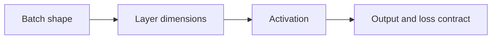
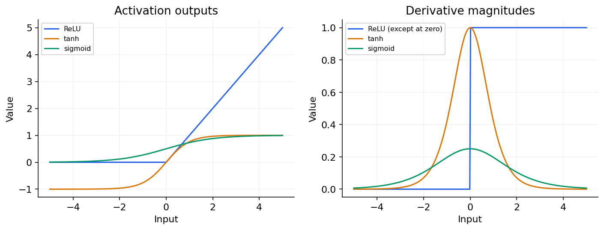

# 01 — Tensors, batches, layers and output contracts

[Course map](README.md) · [Practicals](../02-practicals/README.md) · [Questions](../03-questions-and-answers/worked-questions.md#lesson-01)

Activation choice changes signal and gradient behaviour. See the worked example for its assumptions.

## On this page

- [The idea](#the-idea)
- [Work through it](#work-through-it)
- [Common mistakes and practical limits](#common-mistakes-and-practical-limits)

## The idea

**Analogy:** A tensor is a labelled stack of grids; a shape error is often a mistaken assumption about what each axis means.

A tensor generalizes vectors and matrices. Record the meaning of every axis: batch, time, channels, height or features. For a batch $X$ of shape $(B,p)$ and weights $W$ of shape $(p,h)$, $XW+b$ has shape $(B,h)$ when the bias broadcasts correctly. Frameworks differ in stored weight orientation and image-axis conventions, so inspect actual shapes rather than copying a diagram mechanically.

A dense layer forms affine combinations; a nonlinear activation allows successive layers to represent more than one affine map. ReLU, sigmoid, tanh and GELU have different numerical/optimization behaviour. Choose the last layer and loss from the target: scalar regression, binary, exclusive multiclass and multilabel outputs are distinct contracts.

Normalize inputs using training statistics where appropriate. Check dtypes, device placement and target shapes. Integer class labels differ from one-hot distributions. Many cross-entropy implementations accept logits and perform stable normalization internally; applying an unnecessary softmax first can change the intended loss computation.

## Work through it

A32-example batch with 10 features entering a 16-unit layer yields shape(32,16). If there are 3 exclusive classes, a final projection produces(32,3) logits. Targets can be shape(32,) integer class IDs under a compatible loss.

One neuron $x=2,w=.1,b=0$ has logit.2 and sigmoid probability 0.549834. This is logistic regression before adding hidden layers.

## Common mistakes and practical limits

Do not silently squeeze away the batch dimension when batch size 1. A shape-compatible broadcast can still be semantically wrong. Match logits/probability expectations to the actual loss API.

---

[Subject home](../README.md) · [Backpropagation, initialization, optimizers and regularization →](lesson-02-backprop-and-training.md)
