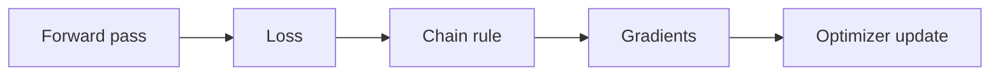

# 02 — Backpropagation, initialization, optimizers and regularization

[Course map](README.md) · [Practicals](../02-practicals/README.md) · [Questions](../03-questions-and-answers/worked-questions.md#lesson-02)

## On this page

- [The idea](#the-idea)
- [Work through it](#work-through-it)
- [Common mistakes and practical limits](#common-mistakes-and-practical-limits)

## The idea

**Analogy:** Backprop sends a responsibility signal backward; the optimizer decides how to act on that signal.

A computation graph records how a loss depends on intermediate values and parameters. Backprop applies the chain rule efficiently. Gradients can accumulate between backward calls, so a training loop must reset them deliberately unless accumulation is intended. Training, validation and inference modes have different roles.

For sigmoid plus binary log loss, the logit derivative is $p-y$. Weight gradients multiply that error by the input. SGD, momentum and Adam turn gradients into updates; Adam does not make every learning-rate choice safe. Initialization should match the activation/architecture to avoid vanishing/exploding signal scales.

Regularization includes weight decay, dropout, augmentation and early stopping. Batch normalization uses training batch information and stored statistics for normal inference; dropout is typically inactive during evaluation. Loss reduction, batch size, learning rate and number of updates interact. Monitor validation behaviour, gradient norms and numerical issues rather than only a falling training curve.

## Work through it

For $x=2,y=1,w=.1,b=0$, probability 0.549834 gives gradients $g_w=-.900332,g_b=-.450166$. At rate.1, updated weights are.190033 and.045017; probability rises to.604699.

A dataset of 1000 examples and batch 100 gives 10 updates per full epoch. Training 20 epochs therefore gives 200 updates if every batch is processed once per epoch. Gradient accumulation changes the effective update schedule.

## Common mistakes and practical limits

Do not confuse an epoch with one parameter update. Selecting the best test checkpoint leaks test information. Weight decay and an L2 term are not identically implemented under every adaptive optimizer.

---

[← Tensors, batches, layers and output contracts](lesson-01-tensors-and-shapes.md) · [Convolution, pooling, residual networks and transfer learning →](lesson-03-convolution-and-vision.md)
