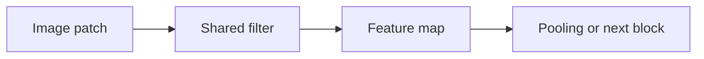
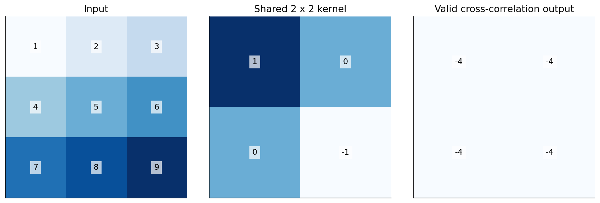

# 03 — Convolution, pooling, residual networks and transfer learning

[Course map](README.md) · [Practicals](../02-practicals/README.md) · [Questions](../03-questions-and-answers/worked-questions.md#lesson-03)

A shared kernel produces local weighted sums. See the worked example for its assumptions.

## On this page

- [The idea](#the-idea)
- [Work through it](#work-through-it)
- [Common mistakes and practical limits](#common-mistakes-and-practical-limits)

## The idea

**Analogy:** A convolution slides the same detector across an image, sharing the rule rather than learning one per location.

A convolutional filter combines a local patch into an output value using shared weights. Stride controls movement; padding controls border handling; dilation spaces sampled kernel positions. For one spatial dimension, output size is $\lfloor(n+2p-d(k-1)-1)/s+1\rfloor$. Channels and kernel counts determine feature dimensions and parameter count.

Pooling summarizes local regions; it changes resolution and information retention. Residual connections add a learned transformation to an identity/projection path, helping signal and gradient flow. A CNN's locality/shared-filter bias differs from an unconstrained dense image model.

Transfer learning reuses pretrained features. Start with a frozen backbone and new head when appropriate, then consider careful fine-tuning with smaller rates and task-specific validation. Match input normalization, image dimensions and class semantics. Augmentations must preserve the target: flipping a digit or medical orientation is not always label preserving. Split near-duplicate images, patients or acquisition sites appropriately.

## Work through it

A32×32 image,3×3 kernel, padding 1 and stride 1 keeps spatial size 32. Stride 2 gives 16 under the stated formula. A3-input-channel,8-filter 3×3 convolution with one bias per filter has $8(3\times3\times3+1)=224$ parameters.

Classification predicts an image label; detection adds object locations; segmentation labels pixels. Accuracy alone does not evaluate all three tasks.

## Common mistakes and practical limits

Randomly splitting frames from one video can leak near-identical images across sets. Pretraining does not guarantee transfer to a new domain. A larger receptive field is not automatically a meaningful semantic explanation.

---

[← Backpropagation, initialization, optimizers and regularization](lesson-02-backprop-and-training.md) · [Text cleaning, tokenization, counts, TF–IDF and embeddings →](lesson-04-text-representations.md)
