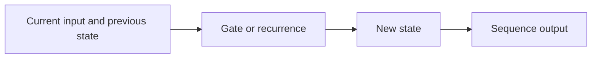

# 05 — RNNs, LSTMs, GRUs and sequence learning

[Course map](README.md) · [Practicals](../02-practicals/README.md) · [Questions](../03-questions-and-answers/worked-questions.md#lesson-05)

## On this page

- [The idea](#the-idea)
- [Work through it](#work-through-it)
- [Common mistakes and practical limits](#common-mistakes-and-practical-limits)

## The idea

**Analogy:** A recurrent state is a notebook carried through a sequence, updated after each new observation.

An RNN updates $h_t=\phi(W_xx_t+W_hh_{t-1}+b)$ and uses state to represent preceding context. Backpropagation through time links repeated parameter use across steps. Long chains can cause vanishing/exploding gradients. Truncated training and gradient clipping manage selected issues but do not guarantee long-range understanding.

An LSTM introduces a cell state with gates controlling retained, written and exposed information. Standard forget/input/output gates use sigmoids; candidate content often uses tanh. A GRU uses a related simpler gated state. Bidirectional models see both directions and suit tasks where the entire sequence exists, but can leak future information in causal forecasting.

Pad variable-length batches deliberately and mask positions appropriately. Distinguish many-to-one classification, per-step labelling and sequence generation. Teacher forcing uses known previous outputs during training; inference uses generated outputs, creating a training/inference mismatch that must be evaluated.

## Work through it

A recurrent state sequence can update a running sum:$h_t=h_{t-1}+x_t$, starting 0. Inputs[2,3,−1]produce[2,5,4]. This simple state illustrates memory without claiming a learned RNN always learns arithmetic.

For a next-word model, each position predicts a later token from earlier context. A bidirectional representation that already reads the target token would make that evaluation invalid.

## Common mistakes and practical limits

A long input window does not prove a model uses all positions. Keep hidden state between batches only when batch ordering and sequence identity make that valid. Evaluate generation, not only teacher-forced token loss.

---

[← Text cleaning, tokenization, counts, TF–IDF and embeddings](lesson-04-text-representations.md) · [Attention, positional information and transformers →](lesson-06-attention-and-transformers.md)
