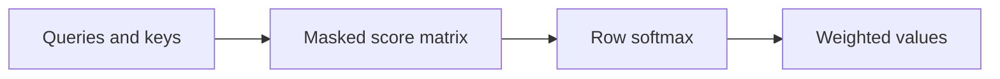
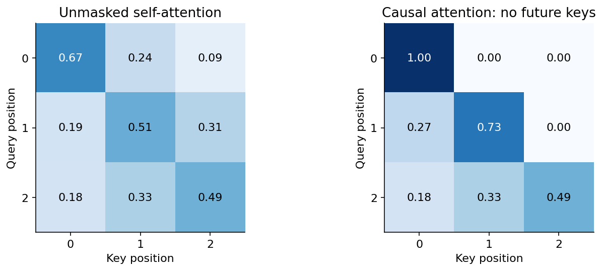

# 06 — Attention, positional information and transformers

[Course map](README.md) · [Practicals](../02-practicals/README.md) · [Questions](../03-questions-and-answers/worked-questions.md#lesson-06)

Each query has a normalized row of attention weights. See the worked example for its assumptions.

## On this page

- [The idea](#the-idea)
- [Work through it](#work-through-it)
- [Common mistakes and practical limits](#common-mistakes-and-practical-limits)

## The idea

**Analogy:** Attention is a content-based lookup: a query decides which stored information is relevant.

Scaled dot-product attention forms $QK^T/\sqrt{d_k}$, applies a mask where needed, normalizes each query row with softmax and multiplies by $V$. Queries and keys determine weights; values are the combined information. Multi-head attention learns several projected views. Positional information is needed because ordinary attention alone does not encode sequence order in the same way as recurrence.

Transformer blocks combine attention, feed-forward layers, residual connections and normalization. Encoder-style representations can use full available context; causal decoders mask future positions. Encoder–decoder cross-attention queries encoder outputs from decoder states. Architecture, tokenizer and training objective jointly define behaviour.

Attention has computational and memory costs that grow with sequence length in ordinary full implementations. Context length is a capacity limit, not a guarantee of faithful use. Evaluate long-context retrieval, distractors, positional effects and truncation. An attention weight is not automatically a faithful causal explanation of a model decision.

## Work through it

For one query with logits[0,ln 3], softmax weights are[.25,.75]. Values[2,6]produce weighted output $.25(2)+.75(6)=5$. With a causal mask excluding the second key, the only allowed value is 2.

A sequence of length $n$ has an $n\times n$ full self-attention score matrix per head. Doubling length quadruples that score count before implementation-specific optimizations.

## Common mistakes and practical limits

Do not apply softmax over the wrong axis. A padding/causal mask changes which positions are eligible and must match the task. Claims about attention explaining a decision need separate evidence.

---

[← RNNs, LSTMs, GRUs and sequence learning](lesson-05-recurrent-sequences.md) · [Autoencoders, VAEs, GANs, diffusion and language-model training →](lesson-07-generative-models-and-evaluation.md)
